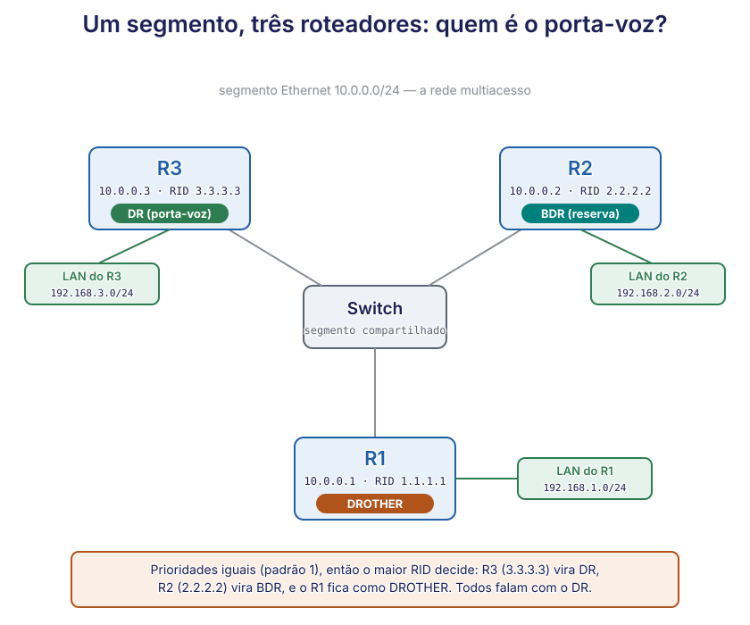

# 🟢 Lab 7 — OSPF multiacesso: quem é o porta-voz, e quanto custa o caminho

**Disciplina:** {{CODIGO}} — Redes de Computadores II — Uniube 
**Professor:** Romualdo Mathias Filho · **romualdo.filho@uniube.br** 
**Semana:** S13 · **Formato:** prática em Packet Tracer · 75 min · **formativo (sem nota)** 
**Turmas práticas:** P11 segunda · VIA215 — P12 quinta · VIA216 
**Pré-requisito:** ter feito o **Lab 6** (OSPF área única) — você já sabe ligar o OSPF e ver a adjacência subir

---

<b>Nosso caminho até aqui</b>

Tente responder de cabeça. Depois abra e confira. Isto vem do Lab 6 e da teórica de hoje — é o chão
desta prática.

Qual linha o IOS imprime sozinho quando dois roteadores viram vizinhos OSPF?

**A linha `%OSPF ... from LOADING to FULL`.** `FULL` é o estado de uma adjacência saudável: os dois
terminaram de trocar o mapa. É o momento que você esperou aparecer no Lab 6.

O OSPF (Open Shortest Path First) escolhe o caminho pelo número de saltos?

**Não.** Ele escolhe pelo **menor custo acumulado**, e o custo vem da largura de banda do enlace.
Contar saltos é o RIP (Routing Information Protocol), não o OSPF.

No Lab 6, por que você não viu eleição de DR/BDR?

**Porque o link era ponto a ponto** — só dois roteadores. A eleição de porta-voz só faz sentido
quando **vários** roteadores dividem o mesmo segmento. É exatamente isso que você monta hoje.

<figure class="au-fig">

<figcaption class="au-legenda">A topologia de hoje: um switch central com R1, R2 e R3 na mesma rede Ethernet (o segmento multiacesso), cada roteador com a sua própria LAN. É esse segmento compartilhado que faz nascer a eleição de <b>DR</b> e <b>BDR</b> — no Lab 6, ponto a ponto, ela não existia.</figcaption>
</figure>

---

## 📌 0. A teoria mínima para hoje: por que um segmento com muitos roteadores elege um porta-voz [Conceito ⏳ 10 min]

A teórica de hoje (Aula 13) explica o **porquê** por dentro. Este bloco dá só o operacional: o
suficiente para cada comando que você vai digitar fazer sentido.

### 0.1 O pulo em relação ao Lab 6

No Lab 6 dois roteadores conversavam por um link direto, um de cada lado. Hoje você liga **três**
roteadores ao **mesmo switch**, na **mesma rede Ethernet**. Isso é uma **rede multiacesso** (vários
roteadores compartilhando um segmento), e ela cria um problema novo: se cada roteador formasse
adjacência plena com todos os outros, seriam conversas demais e repetidas — todos ali veem a mesma
rede.

| | Lab 6 (ponto a ponto) | Lab 7 (multiacesso) — hoje |
| :-- | :-- | :-- |
| Como os roteadores se ligam | um cabo direto entre dois | todos no mesmo switch |
| Quantos no segmento | dois | três (ou mais) |
| Há eleição de porta-voz? | não — com dois, não há caos a conter | **sim** — nasce o DR e o BDR |
| Com quem cada um fica `FULL` | com o único vizinho | só com o DR e o BDR |

> [!NOTE] 📖 Dois papéis que o OSPF elege sozinho
> **DR (Designated Router)** — o **porta-voz** do segmento. Todos os roteadores falam com ele; ele
> coleta o que cada um sabe e repassa para o segmento inteiro.
>
> **BDR (Backup Designated Router)** — o **reserva**. Acompanha tudo o que o DR faz e assume na hora
> se o DR cair, sem precisar de uma eleição nova no momento crítico.

### 0.2 Quem vira DR — e a pegadinha da não-preempção

A eleição segue uma ordem simples:

| Ordem | Critério | Regra |
| :-- | :-- | :-- |
| 1º | **Prioridade** da interface OSPF | **Maior** prioridade vence (padrão: 1; faixa 0–255) |
| 2º (desempate) | **RID** (Router ID) | Prioridades iguais → vence o **maior** RID |
| — | Prioridade **0** | O roteador **não participa** — nunca será DR nem BDR |

O **RID** (Router ID) é o identificador do roteador no OSPF: por padrão, o maior endereço IP de uma
interface ativa (ou de uma *loopback*, se houver). Como hoje todas as prioridades começam no padrão
**1**, a eleição vai cair no desempate: **vence o maior RID**.

> [!WARNING] ⚠️ O OSPF é não preemptivo
> Depois que o DR é eleito, ele **continua DR até cair** — mesmo que chegue depois um roteador com
> prioridade maior. Subir a prioridade de alguém **não** o promove na hora; a troca só acontece
> quando o DR atual sai do ar ou você força uma reeleição. Guarde isso: é o engano número 1 deste
> lab.

### 0.3 Os comandos novos de hoje

Você já conhece `router ospf 1` e `network ... area 0` do Lab 6. Hoje entram quatro:

| Comando | O que faz |
| :-- | :-- |
| `router-id A.B.C.D` | fixa o Router ID (identidade) do roteador no OSPF, em vez de deixar o IOS escolher |
| `ip ospf priority N` | define a prioridade da interface na eleição (0 = não participa) |
| `clear ip ospf process` | reinicia o processo OSPF e **força uma nova eleição** (responda `yes`) |
| `bandwidth N` | ajusta a banda declarada da interface em kbps — muda o **custo** calculado |

<b>Pronto para o teclado quando:</b> você sabe dizer, sem olhar, por que uma rede multiacesso elege um porta-voz, qual é o critério da eleição quando todas as prioridades são iguais, e por que subir a prioridade de um roteador não o torna DR na hora.

---

## 📌 1. Monte o segmento multiacesso e veja quem virou DR [Mão na massa ⏳ 27 min]

### 1.1 Exercício 1 — a topologia dos três roteadores [⏳ 8 min]

Monte (ou abra o `.pkt` que eu passo) esta topologia: um **switch** central (um `2960` serve) com
**R1**, **R2** e **R3** (roteadores `2911`), cada um ligado ao switch pela **GigabitEthernet0/0**.
As três `g0/0` ficam no **mesmo segmento Ethernet** `10.0.0.0/24`, e cada roteador tem a sua **LAN**
na `g0/1`:

| Roteador | g0/0 (segmento compartilhado) | g0/1 (LAN própria) | PC de teste |
| :-- | :-- | :-- | :-- |
| R1 | `10.0.0.1 /24` | `192.168.1.1 /24` | `192.168.1.10` |
| R2 | `10.0.0.2 /24` | `192.168.2.1 /24` | `192.168.2.10` |
| R3 | `10.0.0.3 /24` | `192.168.3.1 /24` | `192.168.3.10` |

Dê **`no shutdown`** nas interfaces usadas dos três roteadores, e configure cada PC com IP, máscara
`255.255.255.0` e **gateway** apontando para a `g0/1` do roteador da sua LAN.

> [!TIP] 💡 Por que um switch no meio, e não cabos entre os roteadores
> O switch é o que torna o segmento **multiacesso**: os três roteadores ficam na mesma rede Ethernet,
> como se estivessem no mesmo corredor. É esse compartilhamento que faz o OSPF precisar de um
> porta-voz. Se você ligasse os roteadores em pares por cabos diretos, teria três links ponto a
> ponto e **nenhuma** eleição — exatamente o Lab 6, de novo.

### 1.2 Exercício 2 — ligue o OSPF nos três [⏳ 9 min]

Em **cada** roteador, o par de comandos do Lab 6 — anunciando o segmento `10.0.0.0` e a LAN local,
os dois na **área 0** — e, hoje, um comando a mais: **fixar o Router ID à mão**, para a eleição
ficar previsível.

<b>R1</b> · fixa o Router ID e anuncia o segmento e a LAN do R1

R1(config)# router ospf 1
R1(config-router)# router-id 1.1.1.1
R1(config-router)# network 10.0.0.0 0.0.0.255 area 0
R1(config-router)# network 192.168.1.0 0.0.0.255 area 0
R1(config-router)# end

> [!NOTE] 📖 Por que fixar o Router ID
> Sem o comando `router-id`, o OSPF escolhe sozinho o RID (Router ID) pegando o **maior endereço IP**
> de uma interface ativa — aqui seria `192.168.1.1` no R1. Isso funciona, mas o RID vira refém do
> endereçamento e muda se você mexer numa interface. Fixá-lo com `router-id 1.1.1.1` (no R2 use
> `2.2.2.2`, no R3 use `3.3.3.3`) deixa a identidade de cada roteador **explícita e estável** — é a
> prática recomendada em rede de verdade, e é o que faz a eleição de hoje ser previsível.

Repita no **R2** (`router-id 2.2.2.2`, LAN `192.168.2.0`) e no **R3** (`router-id 3.3.3.3`, LAN
`192.168.3.0`). À medida que o segundo e o terceiro sobem, o IOS imprime sozinho as linhas de
adjacência:

<b>R3</b> · as adjacencias subindo (o IOS imprime sozinho)

%OSPF-5-ADJCHG: Process 1, Nbr 10.0.0.1 on GigabitEthernet0/0 from LOADING to FULL, Loading Done
%OSPF-5-ADJCHG: Process 1, Nbr 10.0.0.2 on GigabitEthernet0/0 from LOADING to FULL, Loading Done
! dois vizinhos ja em FULL. Num segmento multiacesso voce sobe adjacencia com o DR e o BDR.

<b>Pronto quando:</b> os três roteadores subiram o OSPF e você viu linhas <code>to FULL</code> aparecerem. Ainda não olhe quem é DR — isso é o próximo exercício, e vale apostar antes.

### 1.3 Exercício 3 — aposte, depois descubra quem é DR e BDR [⏳ 10 min]

Aposte antes de ver: as três interfaces estão com a prioridade padrão (1). Os Router ID foram fixados no Exercício 2: <code>1.1.1.1</code> (R1), <code>2.2.2.2</code> (R2) e <code>3.3.3.3</code> (R3). Quem vira <b>DR</b>, e quem vira <b>BDR</b>?

**DR = R3; BDR = R2.** Com as prioridades empatadas em 1, o desempate é o **maior RID**. O R3 tem o
maior (`3.3.3.3`), então é o DR; o segundo maior (`2.2.2.2`, o R2) fica como BDR; o R1 fica como
`DROTHER` (nem DR, nem BDR). Como você fixou o RID à mão no Exercício 2, a eleição é previsível: é
**exatamente** por isso que fixar o Router ID vale a pena — você sabe de antemão quem vai mandar no
segmento.

Agora confirme na tela. O comando que responde "quem são meus vizinhos e quem manda no segmento" é
o `show ip ospf neighbor`:

<b>R1</b> · os vizinhos do R1 e o papel de cada um

R1# show ip ospf neighbor
Neighbor ID     Pri   State           Dead Time   Address      Interface
2.2.2.2           1   FULL/BDR        00:00:33    10.0.0.2     GigabitEthernet0/0
3.3.3.3           1   FULL/DR         00:00:31    10.0.0.3     GigabitEthernet0/0
! do ponto de vista do R1: o R3 (3.3.3.3) e o DR, o R2 (2.2.2.2) e o BDR. O R1 e DROTHER.

> [!NOTE] 📖 Por que o R1 vê só dois vizinhos, e não "todos com todos"
> O R1 forma adjacência **plena** apenas com o **DR** e o **BDR** — por isso aparecem só esses dois
> em `FULL`. Entre dois `DROTHER` (o R1 e qualquer outro roteador comum) o estado fica em `2-WAY`:
> eles se conhecem, mas não trocam o banco completo, porque o DR já faz essa ponte. É assim que o
> OSPF corta a conversa redundante.

<b>Pronto quando:</b> você identificou, na tela, quem é DR e quem é BDR, e sabe explicar em voz alta por que foi o RID que decidiu (as prioridades estavam todas em 1).

---

## 📌 2. Force a eleição, e confira o custo [Mão na massa ⏳ 23 min]

### 2.1 Exercício 4 — faça o R1 virar DR com prioridade [⏳ 11 min]

Hoje o R1 é `DROTHER`. Vamos promovê-lo a DR — não pelo RID (que não dá para escolher à mão sem
mexer em IP), mas pela **prioridade**, que é o primeiro critério. Na interface do segmento do R1:

<b>R1</b> · sobe a prioridade da interface do segmento para 10

R1(config)# interface GigabitEthernet0/0
R1(config-if)# ip ospf priority 10
R1(config-if)# end

Aposte antes de ver: você acabou de pôr prioridade 10 no R1 — a maior do segmento. Olhe o <code>show ip ospf neighbor</code> <b>agora</b>, sem reiniciar nada. O R1 já virou DR?

**Não — ainda não.** O OSPF é **não preemptivo**: o R3 continua DR, mesmo o R1 tendo agora
prioridade maior. A prioridade nova só é levada em conta na **próxima eleição**. Enquanto o DR atual
estiver de pé, nada muda. Esse é o ponto que mais derruba gente em prova.

Para a prioridade valer, **force uma nova eleição** reiniciando o processo OSPF (faça nos três, ou
ao menos no DR atual):

<b>R1</b> · forca a reeleicao reiniciando o processo OSPF

R1# clear ip ospf process
! Reset ALL OSPF processes? [no]: yes
! ... segundos depois, as adjacencias sobem de novo:
%OSPF-5-ADJCHG: Process 1, Nbr 3.3.3.3 on GigabitEthernet0/0 from LOADING to FULL, Loading Done

Confira de novo — agora o R1 deve ser o DR:

<b>R1</b> · depois da reeleicao: o R1 virou DR

R1# show ip ospf interface GigabitEthernet0/0
  Process ID 1, Router ID 1.1.1.1, Network Type BROADCAST, Cost: 1
  State DR, Priority 10
! State DR + Priority 10: a prioridade maior venceu na nova eleicao.

> [!TIP] 💡 Teste rápido da não-preempção
> Para provar o conceito ao contrário: baixe a prioridade do R1 de volta para 1 **sem** reiniciar o
> processo. Ele **continua** DR — porque não houve eleição nova. Só ao `clear ip ospf process` é que
> o posto volta a ser disputado. "A configuração mudou" não é "o comportamento mudou".

### 2.2 Exercício 5 — leia o custo na interface e na tabela [⏳ 7 min]

O OSPF calcula o custo pela fórmula **referência ÷ banda** (referência padrão 100 Mbps na Cisco).
Dois comandos mostram o custo:

<b>R1</b> · o custo calculado para a interface

R1# show ip ospf interface GigabitEthernet0/0
  Process ID 1, Router ID 1.1.1.1, Network Type BROADCAST, Cost: 1
! Cost: 1 -- Gigabit, com a referencia padrao de 100 Mbps, da custo 1 (minimo).

<b>R1</b> · o custo acumulado ate a LAN de outro roteador

R1# show ip route ospf
! Codigos: O - OSPF
O    192.168.2.0/24 [110/2] via 10.0.0.2, 00:03:40, GigabitEthernet0/0
O    192.168.3.0/24 [110/2] via 10.0.0.3, 00:03:40, GigabitEthernet0/0
! [110/2]: 110 = distancia administrativa do OSPF; 2 = custo acumulado ate a LAN.

> [!NOTE] 👉 Confira o número na sua tela
> O `2` do `[110/2]` é o custo acumulado: a soma dos custos das interfaces no caminho até a LAN do
> vizinho. Com links Gigabit (custo 1 cada), o valor típico é **2**, mas o Packet Tracer pode exibir
> um custo ligeiramente diferente conforme a versão e as interfaces contadas. **Leia o número que
> aparece na sua simulação** e confira se ele bate com a soma dos custos das interfaces — é a leitura
> que importa, não decorar o `2`.

Aposte antes de ver: no R1, você baixa a banda declarada da <code>g0/0</code> com <code>bandwidth 10000</code> (10 Mbps, em kbps) e reinicia o processo. O que acontece com o <code>Cost</code> dessa interface?

**Sobe para 10.** Com a banda em 10 Mbps, a conta vira 100 ÷ 10 = **10**. O custo da interface
passa de 1 para 10, e qualquer rota que dependa de sair por ela fica mais "cara". É a fórmula em
ação: mexer na banda mexe no custo. (Desfaça com `no bandwidth` ao terminar.)

### 2.3 Exercício 6 — a quebra deliberada: tire o R2 da eleição [⏳ 5 min]

Ponha prioridade **0** na interface do segmento do R2 e force a reeleição. Prioridade 0 significa
"não participa":

<b>R2</b> · prioridade 0 = fora da eleicao de DR/BDR

R2(config-if)# ip ospf priority 0
R2# clear ip ospf process
! depois da reeleicao, no show ip ospf neighbor dos outros:
2.2.2.2           0   FULL/DROTHER    00:00:35    10.0.0.2     GigabitEthernet0/0
! Pri 0 e papel DROTHER: o R2 nunca mais sera DR nem BDR neste segmento, por mais alto que seja o RID.

Depois **desfaça** (`ip ospf priority 1` no R2 e `clear ip ospf process`) para voltar ao estado
normal.

<b>Critério de pronto do bloco 2:</b> você viu o DR <b>mudar</b> ao forçar a eleição com prioridade, provou que a prioridade sozinha não troca o DR sem reeleição, leu o <code>Cost</code> na interface e o custo acumulado no <code>[110/2]</code> da tabela, e tirou o R2 da disputa com prioridade 0.

---

<b>🔌 Slot interativo — o quarto roteador</b>

Quem terminar antes acrescenta um **R4** ao mesmo switch (`10.0.0.4/24`), com a sua LAN
(`192.168.4.0/24`), e liga o OSPF nele na **área 0**. Antes de reeleger, **preveja**: com o R1 em
prioridade 10 (e DR), quem o R4 vê como DR? E se você der prioridade 20 ao R4 e reiniciar o
processo — ele toma o posto? Confirme com `show ip ospf neighbor`.

<b>Plano B — se o Plickers ou a internet do campus cair:</b> o exercício não depende de arquivo nenhum. É só acrescentar o R4 à topologia que já está na sua tela e repetir o par de comandos <code>router ospf 1</code> + os dois <code>network ... area 0</code>.

---

<b>A conferência — os 6 itens que eu passo olhando</b>

Eu passo nas bancadas durante os blocos 1 e 2 e confiro estes seis na sua tela. Todos são
**re-executáveis**: eu peço o comando e leio o resultado, você não precisa ter anotado nada. **Este
lab é formativo — a conferência não vira nota; serve para você sair daqui sabendo que funcionou.**

1. Os três roteadores ligados ao mesmo switch, com as `g0/0` em `10.0.0.0/24` e as LANs em `up/up`.
2. `show ip ospf neighbor` no R1 listando **dois** vizinhos em `FULL`, um `/DR` e um `/BDR`.
3. Você diz, antes de rodar, quem deve ser o DR pelo **maior RID** — e a tela confirma.
4. Depois do `ip ospf priority 10` + `clear ip ospf process`, o R1 aparece como `State DR`.
5. Você mostra a **não-preempção**: a prioridade nova só valeu **depois** da reeleição (relato seu do antes/depois).
6. `show ip ospf interface` com o `Cost`, e `show ip route ospf` com o `[110/2]` — você aponta onde está o custo acumulado.

<b>Critério de pronto:</b> <b>5 dos 6 itens</b> na sua tela. Os itens <b>3 e 5</b> são os que eu mais peço para explicar em voz alta: no 3, por que o RID decidiu; no 5, por que "a configuração mudou" não é "o DR mudou".

---

<b>📋 Resumo — a folha de consulta</b>

| O que você quer | O comando | O que procurar |
|---|---|---|
| Ver vizinhos, estado e quem é DR/BDR | `show ip ospf neighbor` | linhas `FULL/DR` e `FULL/BDR` |
| Ver custo, prioridade e papel local | `show ip ospf interface g0/0` | `Cost:`, `Priority`, `State DR/BDR/DROTHER` |
| Ver as rotas que o OSPF instalou | `show ip route ospf` | linhas `O` com `[110/custo]` |
| Ver OSPF ativo, RID e redes | `show ip protocols` | `Router ID`, `Routing for Networks` |
| Mudar a prioridade de eleição | `ip ospf priority N` (na interface) | `0` = não participa |
| Forçar uma nova eleição | `clear ip ospf process` | o DR pode mudar |

| O erro clássico | A correção |
|---|---|
| "subi a prioridade, logo o R1 já é DR" | não — OSPF é **não preemptivo**; só muda após `clear ip ospf process` |
| "o DR é o roteador mais rápido/central" | não — é quem ganhou em **prioridade**, e no empate em **RID** |
| "prioridade 0 vira DR se o RID for alto" | não — prioridade **0 não participa** da eleição |
| "Gigabit tem custo menor que Fast Ethernet" | não com a referência padrão — **ambos custam 1** |

<b>📝 Para casa — 7 exercícios (formativos, sem nota)</b>

Faça no seu Packet Tracer, sobre a topologia de hoje. Não vale nota — vale chegar na próxima prática
com as perguntas certas. **Traga as dúvidas.**

1. **Refaça do zero**, sem olhar a página: três roteadores no switch, OSPF ligado, até ver quem é DR.
2. **Prove o RID:** no R1, troque o Router ID para `9.9.9.9` (`router-id 9.9.9.9` dentro de
   `router ospf 1`) — o maior do segmento. Reinicie o processo nos três (`clear ip ospf process`).
   Quem vira DR agora, e por quê? (As prioridades continuam em 1, então o maior RID decide.)
3. **Derrube o DR** (`shutdown` na `g0/0` do DR atual). O que o BDR faz? Em quanto tempo? Religue e
   veja se o antigo DR retoma o posto (lembre da não-preempção).
4. **Prioridade 0 em dois roteadores:** deixe só um roteador apto a ser DR. Quem vira BDR então?
5. **Mexa na banda** de uma interface (`bandwidth 1544` = T1) e reinicie o processo. Qual o novo
   `Cost`? Confira a conta: 100 Mbps ÷ 1,544 Mbps.
6. **Acrescente o R4** (o do slot) e confirme que a LAN do R4 aparece como rota `O` nos outros três.
7. **Pergunta para a próxima aula:** se você elevasse a largura de banda de **referência** do OSPF
   (`auto-cost reference-bandwidth`), o custo de um link Gigabit deixaria de empatar com o de um Fast
   Ethernet? Escreva seu palpite e traga.

---

<b>🤔 Para pensar até a próxima aula</b>

Hoje você forçou o R1 a virar DR com prioridade, e viu que a mudança só valeu depois de uma
reeleição. Numa rede de produção, reiniciar o processo OSPF derruba as adjacências por alguns
segundos — todo o roteamento daquele segmento pisca.

**Como você planejaria a troca do DR** numa rede que não pode piscar? Vale mesmo "escolher" o DR à
mão, ou é melhor deixar o OSPF decidir sozinho? Pense no custo de intervir contra o custo de deixar
o protocolo trabalhar.

*Não há resposta nesta página de propósito.*

---

<b>📚 O que sustenta esta prática, com página</b>

Estas são as referências do bloco de roteamento dinâmico; a teórica de hoje (Aula 13) aprofunda cada
uma.

- **KUROSE, J. F.; ROSS, K. W.** *Redes de computadores e a internet: uma abordagem top-down.* 6. ed. São Paulo: Pearson, 2013. seç. 5.3, p. 338–350 — algoritmo de estado de enlace e cálculo de caminho de menor custo, a base da noção de custo que você lê na tabela.
- **TANENBAUM, A. S.; FEAMSTER, N.; WETHERALL, D. J.** *Redes de Computadores.* 6. ed. Porto Alegre: Bookman, 2021. seç. 5.2, p. 262–278 — roteamento por estado de enlace, redes de difusão (multiacesso) e o papel do roteador designado — o porquê do DR/BDR que você elegeu hoje.
- **CISCO NETWORKING ACADEMY.** *CCNA: Enterprise Networking, Security, and Automation (ENSA).* Disponível em: [netacad.com](https://www.netacad.com/). Acesso em: 20 out. 2026. módulos de OSPF de área única — custo, DR/BDR e verificação — `ip ospf priority`, `clear ip ospf process` e a leitura dos `show`. A numeração das subseções **não é citada porque não foi conferida** (o curso exige login): procure pelo título dos tópicos.

<b>➡️ Na próxima aula</b>

Com o OSPF visto por dentro — custo, eleição de porta-voz e os quatro `show` — a rede já sabe rotear
sozinha. O próximo passo é deixá-la **conversar com a internet**: na S14 entra o **NAT** (Network
Address Translation), o truque que faz muitas máquinas internas saírem por um único endereço público.
O Lab 8 é onde você monta isso.

%%
BANCO DE QUESTÕES — Lab 7 (OSPF: custo, DR/BDR e verificação)
Uso interno do professor. 4 questões de múltipla escolha com gabarito.

1) Num segmento multiacesso com três roteadores, todos com prioridade OSPF padrão (1) e Router ID
   1.1.1.1, 2.2.2.2 e 3.3.3.3, quem é eleito DR?
   a) O de RID 1.1.1.1, por ser o menor.
   b) O de RID 3.3.3.3, por ser o maior (desempate por RID, já que as prioridades empatam).
   c) Nenhum — prioridades iguais impedem a eleição.
   d) Os três viram DR ao mesmo tempo.
   GABARITO: b)  —  prioridades iguais em 1, o maior RID (3.3.3.3) desempata e vira DR.

2) Você sobe a prioridade da interface do R1 para 10 (a maior do segmento) e consulta
   'show ip ospf neighbor' logo em seguida, sem reiniciar o processo. O R1 já é o DR?
   a) Sim — a maior prioridade assume imediatamente.
   b) Não — o OSPF é não preemptivo; a prioridade nova só vale na próxima eleição (após clear ip ospf process).
   c) Sim, mas só depois de 40 segundos (Dead Time).
   d) Não — prioridade não decide quem é DR, só o RID decide.
   GABARITO: b)  —  o DR atual permanece até cair ou até uma reeleição forçada.

3) Qual comando mostra, para uma interface, o custo OSPF calculado, a prioridade e o papel local
   (DR, BDR ou DROTHER)?
   a) show ip ospf neighbor
   b) show ip route ospf
   c) show ip ospf interface
   d) show ip protocols
   GABARITO: c)  —  'show ip ospf interface' traz Cost, Priority e State da interface.

4) Uma interface do segmento recebe 'ip ospf priority 0'. Qual o efeito na eleição?
   a) Ela passa a ter a maior chance de virar DR.
   b) Ela vira BDR automaticamente.
   c) O roteador não participa da eleição — nunca será DR nem BDR naquele segmento.
   d) Nada muda; 0 é o valor padrão.
   GABARITO: c)  —  prioridade 0 retira o roteador da disputa de DR/BDR.
%%
