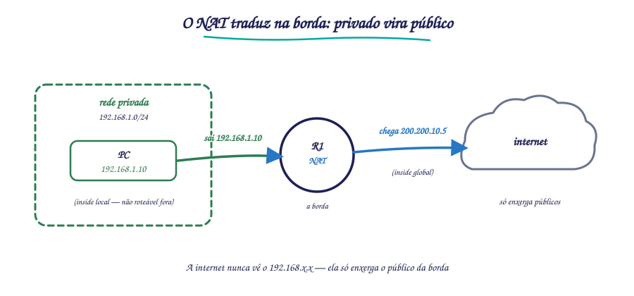
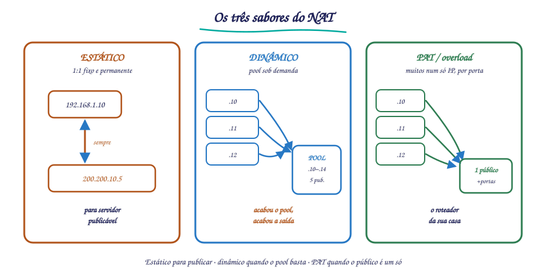
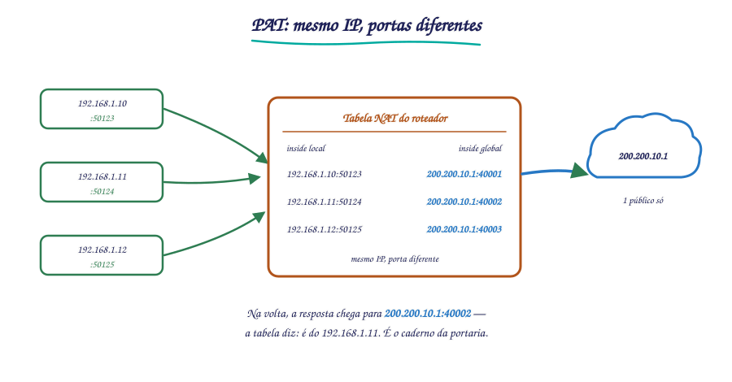

# 🟢 Aula 14 — NAT: estático, dinâmico e PAT

**Disciplina:** {{CODIGO}} — Redes de Computadores II — Uniube 
**Professor:** Romualdo Mathias Filho · **romualdo.filho@uniube.br** 
**Data:** Terça, {{PERIODO}} · **VIA203** · 📘 Teórica (75 min) 
**Turmas práticas:** P11 segunda · VIA215 — P12 quinta · VIA216 
**Página de referência:** [Plano de Ensino e Contrato](./Plano-de-Ensino-e-Contrato)

---

<b>Nosso caminho até aqui</b>

Tente responder de cabeça. Depois abra e confira. Tudo isto veio das últimas aulas — é o chão sobre o qual a aula de hoje se apoia.

O OSPF escolhe o caminho pelo número de saltos?

**Não.** Ele escolhe pelo **menor custo acumulado**, calculado a partir da largura de banda dos enlaces. Contar saltos é o RIP (Routing Information Protocol), não o OSPF (Open Shortest Path First).

O IP 192.168.10.5 do seu Lab 7 pode ser roteado na internet?

**Não.** Os endereços das faixas `10.0.0.0/8`, `172.16.0.0/12` e `192.168.0.0/16` são **privados** (RFC 1918 — Request for Comments 1918): os roteadores da internet os **descartam**. Eles só valem dentro da sua rede. Hoje você vê como eles saem para a internet mesmo assim.

Quando um pacote chega a um roteador, o que ele faz?

Consulta a **tabela de rotas** e encaminha o pacote pela interface certa. Hoje você vê que, na **borda** entre a rede privada e a internet, o roteador faz algo a mais: ele **reescreve o endereço** do pacote antes de encaminhar.

> [!INFO] 🎯 O que você leva desta aula
> - Por que o **NAT** (Network Address Translation) existe — o problema real que ele resolve.
> - Os **quatro endereços** da terminologia NAT: inside local, inside global, outside local e outside global.
> - Os **três sabores**: NAT **estático** (1:1 fixo), NAT **dinâmico** (pool) e **PAT** (muitos num só IP, separados por porta) — quando cada um é a resposta certa.
> - Os comandos de **configuração e verificação** no IOS Cisco — o kit do Lab 8 desta semana.
>
> **📂 Recursos**
> - [Plano de Ensino e Contrato](./Plano-de-Ensino-e-Contrato) — calendário, notas, prazos e regras
> - [Manual do IOS no Packet Tracer](./Manual-do-IOS-no-Packet-Tracer) — comandos do semestre por tema
> - **Packet Tracer** — o **Lab 8 (NAT)** desta semana é o chão prático desta aula

---

## 📌 1. Por que o NAT existe: o endereço que acabou [Fundamentação ⏳ 12 min]

Antes de qualquer comando, a pergunta que o NAT responde: **como a sua casa inteira — celular, notebook, TV, videogame — sai para a internet por um único endereço IP?**

O IPv4 (Internet Protocol version 4) tem cerca de **4,3 bilhões** de endereços (2³² ≈ 4,29 bilhões). Parece muito, mas acabou: os blocos livres foram distribuídos aos provedores há anos. A solução de longo prazo é o IPv6; a solução que **segurou a internet no pé até hoje** foi uma dupla:

1. **Endereços privados** (RFC 1918): as faixas `10.0.0.0/8`, `172.16.0.0/12` e `192.168.0.0/16` podem ser usadas por qualquer rede, quantas vezes quiser — porque **não são roteáveis na internet**. Seu lab inteiro usa privados, e o roteador do provedor descarta qualquer pacote com esses endereços.
2. **NAT** (Network Address Translation): na **borda** entre a rede privada e a internet, um equipamento **traduz** os endereços privados dos seus hosts em endereço(s) público(s) válido(s) — e desfaz a tradução na volta.

<figure class="au-fig">

<figcaption class="au-legenda">Figura 1: o host usa um IP privado dentro da rede; na borda, o NAT o apresenta à internet com um IP público.</figcaption>
</figure>

O efeito prático: milhões de redes privadas usam as **mesmas** faixas `192.168.x.x` ao mesmo tempo, e a internet nunca as vê — ela só enxerga os públicos de cada borda. Foi assim que o IPv4 ganhou mais duas décadas de vida.

> [!NOTE] 📖 NAT não foi feito para ser segurança
> Esconder a rede interna atrás de um público tem um efeito colateral que parece firewall: de fora, ninguém inicia conexão com um privado que não existe na internet. Mas isso é **consequência**, não função — o NAT existe para resolver **escassez de endereços**. Proteção de verdade é trabalho de firewall e de ACLs, assunto da próxima aula.

---

## 📌 2. Os quatro endereços: a terminologia que a prova cobra [Teoria ⏳ 12 min]

O NAT é simples de usar e confuso de **nomear**. A Cisco batizou os quatro endereços envolvidos de um jeito que parece redundante, mas cada um responde a uma pergunta diferente. A chave é o par de eixos: **inside/outside** (de que lado está o host) × **local/global** (como ele é visto).

| Termo | Pergunta que responde | No nosso exemplo |
| :-- | :-- | :-- |
| **Inside local** | Qual é o IP **real** do host **dentro** da rede? | `192.168.1.10` — o IP configurado no PC |
| **Inside global** | Como o host de dentro é visto **lá fora**? | `200.200.10.5` — o público que o NAT empresta a ele |
| **Outside global** | Qual é o IP **real** do destino na internet? | `8.8.8.8` — o servidor lá fora |
| **Outside local** | Como o destino seria visto **de dentro**? | Quase sempre igual ao outside global; raramente muda |

Regra prática para não se perder: **local é como a rede interna enxerga, global é como a internet enxerga**. Na prática, o par que importa no dia a dia é **inside local ↔ inside global**: é a tradução que o seu roteador de borda faz para cada host que sai.

> [!WARNING] ⚠️ O erro clássico de prova
> Inverter **inside global** com **outside global**. Lembre: *inside* é sempre o seu host interno, *outside* é sempre o destino. O **inside global** é **seu** — é o público que **representa a sua rede**. O **outside global** é **do destino** — o IP real do servidor na internet.

---

## 📌 3. NAT estático: um para um, sempre o mesmo [Teoria ⏳ 10 min]

O **NAT estático** é o mapeamento fixo de **um privado para um público**, gravado na configuração. Sempre que o host sai, ele aparece com o **mesmo** público — e, mais importante, a internet pode **iniciar** conexões com ele, porque o mapeamento é permanente.

**Quando usar:** servidores internos que precisam ser alcançados de fora com endereço previsível — um servidor web, um e-mail, uma VPN (Virtual Private Network) de entrada.

A configuração é uma linha por host, mais o papel de cada interface:

<b>R1</b> · NAT estático: o servidor interno ganha um público fixo

R1(config)# ip nat inside source static 192.168.1.10 200.200.10.5
! inside local 192.168.1.10 passa a ser visto la fora como inside global 200.200.10.5
R1(config)# interface GigabitEthernet0/0
R1(config-if)# ip nat inside
R1(config)# interface GigabitEthernet0/1
R1(config-if)# ip nat outside
! sem declarar quem e inside e quem e outside, o NAT nao traduz nada

O detalhe que derruba todo mundo no lab: **declarar as interfaces**. O `ip nat inside source static` só diz **o que traduzir**; é o `ip nat inside` / `ip nat outside` em cada interface que diz **onde** a tradução acontece. Sem isso, a regra existe e nada acontece.

---

## 📌 4. NAT dinâmico: um pool de públicos, quem chega primeiro usa [Teoria ⏳ 10 min]

E se forem **vinte** hosts para sair, e você tiver **cinco** públicos? O estático não escala — um mapeamento manual por host. O **NAT dinâmico** resolve com um **pool** de endereços públicos: o primeiro host que precisa pega o primeiro público livre do pool; quando devolve (a tradução expira), o público volta para o pool.

<b>R1</b> · NAT dinâmico: um pool de públicos atende sob demanda

R1(config)# ip nat pool POOL-LAN 200.200.10.10 200.200.10.14 netmask 255.255.255.0
! o pool tem 5 publicos: .10 ate .14
R1(config)# access-list 1 permit 192.168.1.0 0.0.0.255
! a ACL diz QUEM pode ser traduzido (a LAN inteira)
R1(config)# ip nat inside source list 1 pool POOL-LAN
! amarra: quem a ACL 1 permite sai usando um publico do pool

O limite do dinâmico é exatamente o tamanho do pool: com 5 públicos, o **6º host** que tentar sair **fica sem tradução** — o pacote morre na borda. Não é defeito de configuração, é a matemática do pool.

<figure class="au-fig">

<figcaption class="au-legenda">Figura 2: os três sabores — estático (1:1 fixo), dinâmico (pool compartilhado) e PAT (muitos num só IP).</figcaption>
</figure>

> [!TIP] 💡 Estático ou dinâmico? Pergunte: "de fora, alguém precisa iniciar?"
> **Estático** quando a internet precisa **entrar** (servidor publicável, mapeamento permanente). **Dinâmico** quando os hosts só **saem** — ninguém de fora inicia nada com eles. E quando nem o pool resolve, entra o terceiro sabor.

---

## 📌 5. PAT: a internet inteira da sua casa num IP só [Teoria ⏳ 14 min]

O cenário real da maioria das redes: **um único** IP público, dezenas de hosts. (Mudo o cenário aqui: agora o público da sua casa é `200.200.10.1` — outro exemplo, para mostrar o caso mais comum.) Nem o estático (1:1) nem o dinâmico (pool limitado) resolvem. A resposta é o **PAT** (Port Address Translation), também chamado de **NAT overload**: muitos privados dividem **um** público, e o roteador distingue quem é quem pelo **número da porta**.

Antes de rolar: se 50 hosts saem pelo MESMO IP público, como o roteador sabe, na volta, qual resposta é de qual host?

**Pela porta.** O roteador não troca só o IP de origem — troca também a **porta de origem** de cada conexão, e anota o par na tabela de tradução. Cada conexão vira uma tupla única `IPpúblico:porta` (por exemplo, `200.200.10.1:40001` para um host, `...:40002` para outro). Quando a resposta chega para uma porta específica, a tabela diz exatamente a qual host interno devolver. Mesmo IP, portas diferentes — é isso que desambigua.

A mágica está na tupla. Quando o PC `192.168.1.10` abre uma conexão para a porta 443 de um site, o roteador reescreve: não só o IP vira `200.200.10.1`, mas a **porta de origem** também é trocada — por exemplo, para `200.200.10.1:40001`. Quando o notebook `192.168.1.11` sai para outro site, ele vira `200.200.10.1:40002`. **Mesmo IP, portas diferentes** — e é isso que desambigua na volta.

<figure class="au-fig">

<figcaption class="au-legenda">Figura 3: três hosts privados saindo pelo mesmo IP público — a tabela de tradução distingue cada um pela porta.</figcaption>
</figure>

| Inside local | Inside global (com porta) | Destino |
| :-- | :-- | :-- |
| 192.168.1.10:50123 | **200.200.10.1:40001** | 142.250.78.238:443 |
| 192.168.1.11:50124 | **200.200.10.1:40002** | 151.101.1.140:443 |
| 192.168.1.12:50125 | **200.200.10.1:40003** | 142.250.78.238:443 |

Quando a resposta chega para `200.200.10.1:40002`, o roteador consulta a tabela e devolve ao `192.168.1.11`. Com cerca de **65 mil portas** disponíveis por IP (2¹⁶ = 65.536), um único público atende milhares de conexões simultâneas — é literalmente o que o roteador da sua casa faz agora.

<b>R1</b> · PAT: a LAN inteira sai pela interface pública

R1(config)# access-list 1 permit 192.168.1.0 0.0.0.255
R1(config)# ip nat inside source list 1 interface GigabitEthernet0/1 overload
! overload = PAT: todos da ACL 1 dividem o publico da interface G0/1
R1(config)# interface GigabitEthernet0/0
R1(config-if)# ip nat inside
R1(config)# interface GigabitEthernet0/1
R1(config-if)# ip nat outside

> [!TIP] 💡 A palavra que muda tudo: `overload`
> A configuração do PAT é a do dinâmico com **uma palavra a mais**. Sem `overload`, o `ip nat inside source list 1 interface G0/1` tentaria dar um público por host — e não há. Com `overload`, o roteador passa a traduzir **IP + porta** e todo mundo cabe num IP só. No lab, quando "só um host sai e o resto não", quase sempre é o `overload` que ficou de fora.

---

## 📌 6. A hora de conferir: os comandos show [Teoria ⏳ 8 min]

Teoria é o mapa; a CLI (Command Line Interface) é o território. No Lab 8, três comandos confirmam se o NAT está vivo — e **cada um prova uma coisa diferente**:

| Comando | Pergunta que responde | O que você confirma na tela |
| :-- | :-- | :-- |
| `show ip nat translations` | *"As traduções estão acontecendo?"* | A tabela inside local ↔ inside global, com protocolo e portas (no PAT) |
| `show ip nat statistics` | *"O NAT está ativo e com que volume?"* | Total de traduções, interfaces inside/outside declaradas, expiradas |
| `clear ip nat translation *` | *(não é show — é o reset)* | Limpa a tabela para refazer o teste do zero |

<b>R1</b> · a tabela de traduções ao vivo, com PAT

R1# show ip nat translations
! Pro  Inside global       Inside local        Outside local       Outside global
tcp   200.200.10.1:40001  192.168.1.10:50123  142.250.78.238:443  142.250.78.238:443
tcp   200.200.10.1:40002  192.168.1.11:50124  151.101.1.140:443   151.101.1.140:443
! cada conexao virou uma linha: mesmo inside global, porta diferente = PAT funcionando

> [!TIP] 💡 A ordem que economiza tempo no lab
> Host não navega? Vá do físico ao lógico: **(1)** `ping` do host ao gateway (a LAN está de pé?). **(2)** `ping` do roteador para fora (a borda alcança a internet?). **(3)** `show ip nat statistics` — as interfaces `inside`/`outside` estão declaradas? **(4)** `show ip nat translations` — apareceu alguma tradução? Se a tabela está vazia com a rede de pé, o problema está no `ip nat inside source` — ACL, pool ou o `overload` esquecido.

---

<b>🔌 Momento interativo — vote antes de eu abrir o Packet Tracer</b>

Sua rede tem **40 hosts** e **3 endereços públicos**. Os 3 primeiros hosts navegam; do 4º em diante, ninguém sai. **O que resolve com a menor mudança?** Vote no Plickers.

<b>Plano B — se o Plickers ou a internet do campus cair:</b> mão levantada — aumentar o pool de públicos (um dedo) ou trocar para PAT com `overload` (dois dedos). A resposta e o porquê vêm logo abaixo; o importante é você se comprometer com um palpite antes de ver.

<b>🎧 Podcast da aula — "Como o NAT salvou a internet"</b>

<b>Gerado por IA</b> (NotebookLM) a partir do material da disciplina — se divergir da aula, a aula vence.

<audio controls preload="none" style="width:100%;margin-top:.5rem">
<source src="assets/aula14-nat-podcast.m4a" type="audio/mp4">
Seu navegador não reproduz áudio embutido — <a href="assets/aula14-nat-podcast.m4a">baixe o episódio aqui</a>.
</audio>

<b>📋 Resumo — a folha de consulta</b>

| Conceito | O que é | Como lembrar |
|---|---|---|
| NAT (Network Address Translation) | traduz privado ↔ público na borda | o "intérprete" entre a sua rede e a internet |
| Endereço privado (RFC 1918) | 10/8, 172.16/12, 192.168/16 — não roteável na internet | vale dentro, morre fora |
| Inside local | o IP real do host interno | o `192.168.1.10` do PC |
| Inside global | o público que representa o host lá fora | o "nome público" do seu host |
| Outside global | o IP real do destino na internet | o servidor lá fora |
| NAT estático | 1:1 fixo, permanente | para **servidor** publicável |
| NAT dinâmico | pool de públicos sob demanda | acabou o pool, acabou a saída |
| PAT / overload | muitos privados, 1 público, distinguidos por porta | o roteador da sua casa |
| `show ip nat translations` | a tabela de traduções ao vivo | prova o **resultado** |
| `show ip nat statistics` | NAT ativo, interfaces, volume | prova a **configuração** |

| O erro clássico | A correção |
|---|---|
| "NAT é um firewall" | não — ele traduz endereços; proteger é trabalho de ACL/firewall |
| "o 6º host não sai por culpa da config" | não — o pool dinâmico **esgotou**; a matemática do pool é o limite |
| "configurei o NAT e nada traduz" | faltou declarar `ip nat inside` / `ip nat outside` nas interfaces |
| "dinâmico com `interface` basta para 40 hosts" | não — sem `overload` (PAT), falta público; com, todos cabem em um |

---

<b>🤔 Para pensar até a próxima aula</b>

Hoje você viu que, por trás do PAT, dezenas de hosts aparecem na internet como **um único IP**. Se amanhã um desses hosts é comprometido e ataca um servidor lá fora, **como o alvo do ataque identifica qual era a máquina de verdade** — se, para ele, todas são o mesmo endereço? E o que o administrador da rede precisaria **guardar** para responder a essa pergunta depois? Traga sua hipótese.

*Não há resposta nesta página de propósito.*

---

## 🧩 Antes de fechar: a analogia que amarra tudo

Pense num **prédio comercial com um único telefone público na portaria**. Os endereços privados são os ramais internos: dentro do prédio, cada sala tem o seu, mas nenhum ramal recebe ligação direta de fora. O **NAT estático** é a sala do diretor: a portaria anotou que toda ligação para "o diretor" vai para o ramal 10, e toda ligação que ele faz sai com o nome do diretor — sempre o mesmo, dos dois lados. O **NAT dinâmico** é um fichário com cinco cartões de "linha externa disponível": quem precisa ligar pega um cartão, e quando desliga devolve — acabaram os cinco, o sexto espera. O **PAT** é o que a portaria faz todo dia na prática: uma única linha externa para o prédio inteiro, e ela anota **quem pediu cada ligação** num caderno — "a ligação das 14h para a farmácia era do ramal 12, a das 14h05 para o banco era do ramal 7". Quando a farmácia retorna, ela consulta o caderno e transfere para o ramal certo. O caderno é a tabela `show ip nat translations`; o número do ramal é a **porta**.

---

<b>📚 O que sustenta esta aula, com página</b>

- **KUROSE, J. F.; ROSS, K. W.** *Redes de computadores e a internet: uma abordagem top-down.* 6. ed. São Paulo: Pearson, 2013. seç. 4.4, p. 290–295 — NAT: motivação, funcionamento e a tradução com portas (PAT).
- **TANENBAUM, A. S.; FEAMSTER, N.; WETHERALL, D. J.** *Redes de Computadores.* 6. ed. Porto Alegre: Bookman, 2021. seç. 5.6, p. 402–406 — esgotamento do IPv4, endereços privados e NAT.
- **CISCO NETWORKING ACADEMY.** *CCNA: Enterprise Networking, Security, and Automation (ENSA).* Disponível em: [netacad.com](https://www.netacad.com/). Acesso em: 27 out. 2026. módulo de NAT — estático, dinâmico e PAT, com verificação — configuração e comandos `show ip nat`. A numeração das subseções **não é citada porque não foi conferida** (o curso exige login).

<b>➡️ Na próxima aula</b>

O NAT de hoje decide **quem sai** traduzindo endereços — mas ele não **filtra** nada: se a tradução existe, o pacote passa. Na próxima aula entra a pergunta do policial da rede: **quem pode** e **quem não pode** passar? As **ACLs padrão** (Access Control Lists) — a lógica, a wildcard mask que todo mundo erra na primeira vez, e **onde** posicionar a lista para ela fazer o que você quer, e não o contrário.

%%
BANCO DE QUESTÕES — Aula 14 (NAT: estático, dinâmico e PAT)
Uso interno do professor. 4 questões de múltipla escolha com gabarito.

1) Um servidor interno (192.168.1.10) precisa ser alcançado da internet sempre pelo mesmo
   endereço público. Qual sabor de NAT é o correto, e por quê?
   a) NAT dinâmico, porque o pool garante um público disponível.
   b) PAT, porque economiza endereços.
   c) NAT estático, porque o mapeamento 1:1 é permanente e permite conexões iniciadas de fora.
   d) Nenhum — servidor interno não pode ser alcançado da internet.
   GABARITO: c)  —  só o estático mantém o mapeamento permanente nos dois sentidos; dinâmico e PAT
   só funcionam bem para conexões iniciadas de dentro.

2) Numa tabela `show ip nat translations` com PAT, o que distingue duas conexões de hosts
   diferentes que saem pelo MESMO inside global?
   a) O endereço outside global.
   b) O número da porta traduzida no inside global.
   c) O protocolo (TCP ou UDP).
   d) O tempo de expiração da tradução.
   GABARITO: b)  —  o PAT troca IP + porta; mesma máquina pública, portas diferentes (ex.: 40001, 40002).

3) O NAT dinâmico está configurado com um pool de 5 públicos. O 6º host da LAN tenta navegar.
   O que acontece?
   a) Ele divide o público do 1º host.
   b) Ele fica sem tradução — o pacote morre na borda; o limite é o tamanho do pool.
   c) O roteador cria um 6º público automaticamente.
   d) O roteador reinicia a tabela NAT.
   GABARITO: b)  —  dinâmico sem overload traduz 1:1 por host; esgotado o pool, não há tradução.

4) Um aluno configurou `ip nat inside source list 1 pool POOL-LAN` corretamente, mas nenhum
   host navega e a tabela de traduções está vazia. Qual é a causa mais provável?
   a) A ACL 1 está errada.
   b) Faltou declarar `ip nat inside` e `ip nat outside` nas interfaces.
   c) Faltou a palavra `overload`.
   d) O pool está com a máscara errada.
   GABARITO: b)  —  a regra define O QUE traduzir; são as interfaces que dizem ONDE a tradução
   acontece. Sem elas, nenhum pacote passa pelo NAT.
%%
