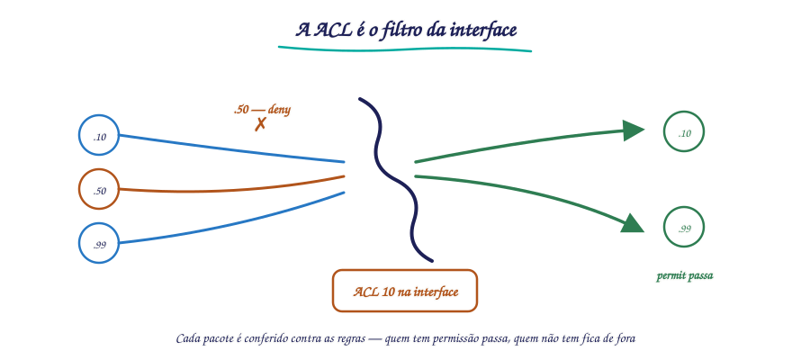
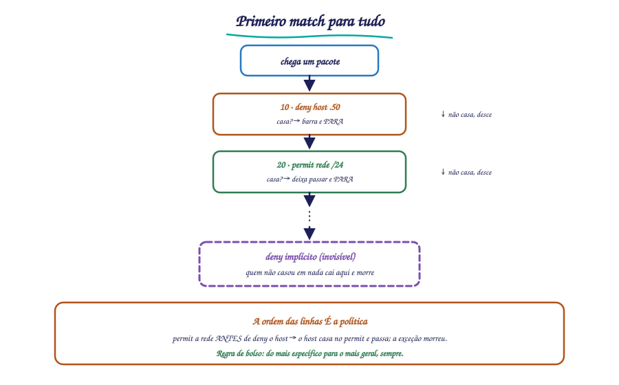
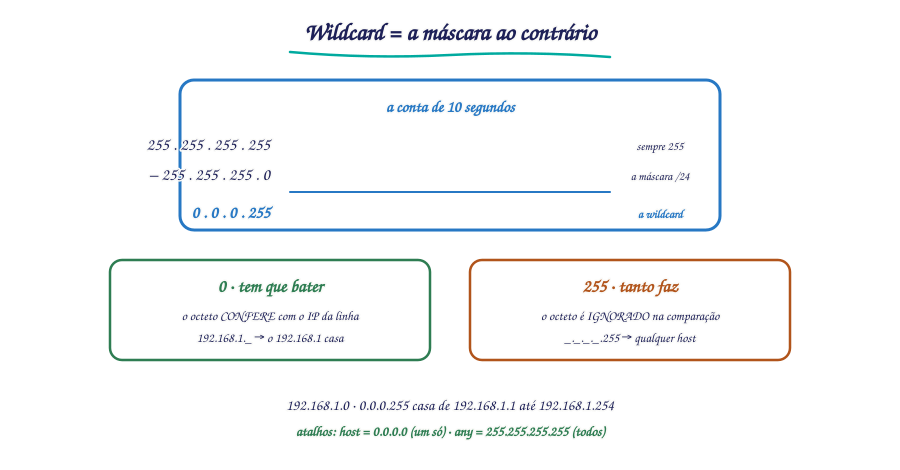
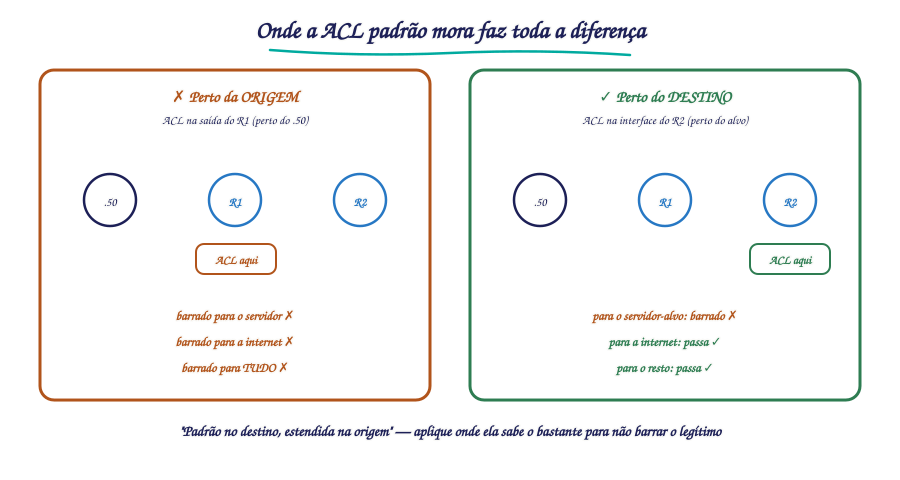

# 🟢 Aula 15 — ACLs padrão: lógica, wildcard e posicionamento

**Disciplina:** {{CODIGO}} — Redes de Computadores II — Uniube 
**Professor:** Romualdo Mathias Filho · **romualdo.filho@uniube.br** 
**Data:** Terça, {{PERIODO}} · **VIA203** · 📘 Teórica (75 min) 
**Turmas práticas:** P11 segunda · VIA215 — P12 quinta · VIA216 
**Página de referência:** [Plano de Ensino e Contrato](./Plano-de-Ensino-e-Contrato)

---

<b>Nosso caminho até aqui</b>

Tente responder de cabeça. Depois abra e confira. Tudo isto veio das últimas aulas — é o chão sobre o qual a aula de hoje se apoia.

Sua rede tem 40 hosts e 1 IP público. Qual sabor de NAT tira todos do sufoco, e como ele distingue quem é quem?

O **PAT** (Port Address Translation, o `overload`): todos dividem o público, e o roteador distingue cada conexão pela **porta** traduzida na tabela — `IPpúblico:40001` para um, `:40002` para outro.

O NAT, em qualquer um dos três sabores, FILTRA alguma coisa?

**Não.** O NAT **traduz** endereços — se a tradução existe, o pacote passa. Ele não pergunta "quem pode?". Filtrar é trabalho de outro mecanismo, e é exatamente o de hoje.

Qual é a máscara de sub-rede da rede 192.168.1.0/24, em decimal?

`255.255.255.0`. Guarde esse número: hoje você vai **invertê-lo** para criar a máscara que a ACL usa — a wildcard mask.

> [!INFO] 🎯 O que você leva desta aula
> - O que é uma **ACL** (Access Control List) e como ela **pensa**: sequencial, primeiro match para tudo, e o `deny` escondido no fim.
> - A **wildcard mask**: a máscara invertida que diz quais bits conferir — e a conta de 10 segundos para obtê-la.
> - A **ACL padrão** (standard): filtra **só pela origem**, e por isso o lugar onde você a aplica muda tudo.
> - **Posicionamento**: por que a ACL padrão vai o **mais perto do destino** possível — e o desastre de aplicá-la perto da origem.
>
> **📂 Recursos**
> - [Plano de Ensino e Contrato](./Plano-de-Ensino-e-Contrato) — calendário, notas, prazos e regras
> - [Manual do IOS no Packet Tracer](./Manual-do-IOS-no-Packet-Tracer) — comandos do semestre por tema
> - **Packet Tracer** — o **Lab 9 (ACLs)** da próxima semana é o chão prático desta aula

---

## 📌 1. Por que filtrar: o roteador que encaminha tudo [Fundamentação ⏳ 10 min]

Até aqui, o roteador da sua topologia faz uma coisa só: **encaminha**. Chegou um pacote, ele consulta a tabela de rotas e manda adiante. O OSPF (Open Shortest Path First) calcula o melhor caminho; o NAT (Network Address Translation) reescreve o endereço na borda. Mas nenhum dos dois pergunta a pergunta do policial: **"você pode passar?"**

E ela precisa ser feita. Cenários que toda rede real tem:

1. A rede do **financeiro** não deveria ser alcançada pela rede dos **alunos**.
2. O **servidor de impressão** aceita trabalho de todos, mas o **servidor de RH**, não.
3. Um laboratório pode **sair** para a internet, mas ninguém de fora deveria **entrar** nele.

Sem um filtro, o roteador encaminha tudo isso de bom grado — a tabela de rotas não tem opinião. A resposta do IOS (Internetwork Operating System, o sistema dos roteadores Cisco) é a **ACL** (Access Control List): uma lista de regras `permit`/`deny` aplicada a uma interface, que decide pacote a pacote quem passa e quem fica de fora.

<figure class="au-fig">

<figcaption class="au-legenda">Figura 1: a ACL é o filtro na interface do roteador — cada pacote é conferido contra as regras, e só quem tem permissão passa.</figcaption>
</figure>

> [!NOTE] 📖 ACL não é firewall, é o tijolo
> Uma ACL é um **filtro de pacotes** por endereço (e, nas estendidas, por protocolo e porta). Um firewall de verdade faz muito mais — inspeção de estado, aplicação, reputação. Mas toda política de segurança em roteador Cisco **começa** pela ACL: é o tijolo com que se constrói o resto.

---

## 📌 2. Como a ACL pensa: três regras que você não pode esquecer [Teoria ⏳ 12 min]

A ACL é só uma lista de linhas. Mas a **lógica** com que o roteador a percorre derruba mais aluno (e mais rede) do que qualquer sintaxe. Três regras, nesta ordem de importância:

### 2.1 Processamento sequencial: de cima para baixo, e para no primeiro match

O roteador lê a ACL **da primeira linha até encontrar uma que case** com o pacote. Achou? **Aplica aquela linha e para** — as linhas de baixo nem são lidas.

<figure class="au-fig">

<figcaption class="au-legenda">Figura 2: o pacote desce a lista; o primeiro match decide, e quem não casa em nada cai no deny implícito.</figcaption>
</figure>

### 2.2 A ordem das linhas muda o resultado

Antes de rolar: duas ACLs têm as MESMAS duas linhas — `deny host .50` e `permit` a rede /24 — mas em ordens opostas. As duas filtram igual?

**Não — e a diferença é total.** A que tem `deny` **antes** barra o .50 e deixa o resto passar. A que tem `permit` **antes** deixa o .50 passar também: ele casa na regra geral na primeira linha, o processamento **para ali**, e o `deny` da segunda linha nunca é lido. Mesmas linhas, políticas opostas — a **ordem** é a política.

Veja o estrago que uma inversão faz:

<b>Lista A</b> · a ordem certa: a exceção antes da regra geral

R1(config)# access-list 10 deny 192.168.1.50
R1(config)# access-list 10 permit 192.168.1.0 0.0.0.255
! o .50 e barrado na linha 1; todo o resto da rede passa na linha 2

<b>Lista B</b> · a MESMA lista, ordem invertida: a exceção morreu

R1(config)# access-list 10 permit 192.168.1.0 0.0.0.255
R1(config)# access-list 10 deny 192.168.1.50
! o .50 casa na linha 1 (permit) e passa; a linha 2 nunca e lida

> [!WARNING] ⚠️ O erro clássico nº 1: a exceção depois da regra geral
> Se a regra ampla (`permit` a rede inteira) vem **antes** da exceção (`deny` um host), a exceção **nunca é avaliada** — o host já casou na ampla. Regra de bolso: **do mais específico para o mais geral**, sempre.

### 2.3 O deny implícito: quem não casa em nada é barrado

Toda ACL termina com uma linha que **não aparece** na configuração: `deny any`. Se o pacote desceu a lista inteira sem casar com nenhuma linha, ele é **descartado**. Consequência direta: uma ACL que só tem `deny` escrito **barra tudo** — porque quem não é negado explicitamente cai no implícito.

<b>O efeito</b> · a mesma lista, com e sem o permit que salva

! Lista so com deny: BARREIRA TOTAL
R1(config)# access-list 10 deny host 192.168.1.50
! .50 morre na linha 1; TODO o resto morre no deny implicito = rede inteira parada
! a MESMA intencao, com o permit que salva:
R1(config)# access-list 10 deny host 192.168.1.50
R1(config)# access-list 10 permit any
! .50 morre na linha 1; todo o resto passa na linha 2 = so o alvo barrado

> [!TIP] 💡 Toda ACL precisa de pelo menos um permit
> Se a sua lista só diz o que **barrar** e não diz o que **deixar passar**, o deny implícito fecha a porta para todo o resto. No lab, "configurei a ACL e a rede inteira parou" é quase sempre isso.

---

## 📌 3. A wildcard mask: a máscara ao contrário [Teoria ⏳ 14 min]

Toda linha de ACL que fala de uma rede usa uma **wildcard mask** — e ela é **o inverso** da máscara de sub-rede que você já conhece. É aqui que todo mundo erra na primeira vez.

A regra de leitura, bit a bit:

- **0** = "este bit **tem que bater**" (confere).
- **1** = "este bit **tanto faz**" (ignora).

A máscara de sub-rede marca com `1` a parte de **rede**; a wildcard marca com `1` a parte **ignorada** (a parte de host). Por isso uma é a inversa da outra — e a conta de 10 segundos é uma subtração:

<b>A conta</b> · wildcard = 255.255.255.255 − máscara de sub-rede

! mascara:    255.255.255.0
! wildcard:   255.255.255.255 - 255.255.255.0
!           = 0.0.0.255
! os 3 primeiros octetos conferem; o ultimo tanto faz = qualquer host da rede

<figure class="au-fig">

<figcaption class="au-legenda">Figura 3: a wildcard é a máscara invertida — 0 confere, 255 ignora; a conta é sempre 255 menos a máscara.</figcaption>
</figure>

Exemplos que cobrem 90% do lab e da prova:

| Você quer casar | Máscara de sub-rede | Wildcard mask | Linha na ACL |
| :-- | :-- | :-- | :-- |
| a rede inteira `192.168.1.0/24` | 255.255.255.0 | **0.0.0.255** | `192.168.1.0 0.0.0.255` |
| a sub-rede `192.168.1.64/26` | 255.255.255.192 | **0.0.0.63** | `192.168.1.64 0.0.0.63` |
| um host só, `192.168.1.50` | 255.255.255.255 | **0.0.0.0** | `192.168.1.50 0.0.0.0` (ou `host 192.168.1.50`) |
| qualquer um | 0.0.0.0 | **255.255.255.255** | `any` |

> [!TIP] 💡 Os dois atalhos que você vai usar toda hora
> `host 192.168.1.50` é a forma curta de `192.168.1.50 0.0.0.0` (um host exato, tudo confere). E `any` é a forma curta de `0.0.0.0 255.255.255.255` (qualquer endereço, tudo ignorado). A prova cobra os dois.

---

## 📌 4. A ACL padrão: olha só para a origem [Teoria ⏳ 10 min]

Existem dois tipos de ACL no IOS. A de hoje é a **ACL padrão** (standard): ela filtra **apenas pelo endereço IP de origem** do pacote. Não olha destino, não olha protocolo, não olha porta. Uma pergunta só: **"de onde você veio?"**

| Característica | ACL padrão |
| :-- | :-- |
| O que avalia | **só o IP de origem** |
| Numeração | **1–99** (e 1300–1999) |
| Sintaxe | `access-list <n> {permit\|deny} <origem> [wildcard]` |
| Força | simples e barata, mas **grossa** — não distingue serviços |

<b>R1</b> · uma ACL padrão completa: barra o .50, deixa o resto da rede

R1(config)# access-list 10 deny host 192.168.1.50
R1(config)# access-list 10 permit 192.168.1.0 0.0.0.255
! especifico antes do geral; o permit salva a lista do deny implicito

> [!WARNING] ⚠️ Uma ACL criada não filtra nada ainda
> Escrever a lista é só metade do trabalho. Ela só passa a filtrar quando é **aplicada a uma interface**, com `ip access-group` — e na **direção** certa. ACL solta na configuração é regra de papel: existe e não faz nada.

---

## 📌 5. Posicionamento: a regra de ouro da ACL padrão [Teoria ⏳ 12 min]

Aplicar a ACL é escolher **interface** e **direção**: `ip access-group 10 in` (filtra o que **entra** na interface) ou `ip access-group 10 out` (filtra o que **sai** dela). E aqui mora a decisão que mais importa no desenho.

Pense na lógica da padrão: ela só sabe **de onde** o pacote veio. Se você a aplicar **perto da origem**, o pacote é barrado **para todos os destinos** — inclusive os legítimos. Você queria impedir o host X de falar com o servidor A, e acabou impedindo o host X de falar com **qualquer um**.

<figure class="au-fig">

<figcaption class="au-legenda">Figura 4: a ACL padrão vai o mais perto do DESTINO possível — perto da origem, ela bloqueia o host para o mundo inteiro.</figcaption>
</figure>

A regra de ouro, então:

| Tipo de ACL | Posição correta | Por quê |
| :-- | :-- | :-- |
| **Padrão** (só origem) | o mais **perto do destino** possível | como ela não sabe o destino, aplicada cedo ela bloqueia demais |
| **Estendida** (origem + destino + portas) | o mais **perto da origem** possível | como ela sabe o destino, pode barrar cedo e poupar a rede — assunto da próxima aula |

> [!TIP] 💡 A frase de bolso
> **"Padrão no destino, estendida na origem."** A lógica é a mesma dos dois lados: aplique a ACL onde ela tem informação suficiente para não barrar tráfego legítimo. A padrão só sabe a origem — então ela espera chegar perto do destino para decidir.

---

## 📌 6. A hora de conferir: aplicar e verificar [Teoria ⏳ 8 min]

No roteador, o fluxo completo é: criar a lista → aplicar na interface → conferir. Os comandos de verificação respondem às duas perguntas que importam:

| Comando | Pergunta que responde | O que você confirma na tela |
| :-- | :-- | :-- |
| `show access-lists` | *"A lista existe e está certa?"* | As linhas da ACL, na ordem, e os **contadores de match** (quantos pacotes já casaram em cada linha) |
| `show ip interface <int>` | *"A ACL está aplicada, onde, em que direção?"* | "inbound access list is 10" / "outgoing access list is 10" na interface |

<b>R1</b> · aplicando e conferindo

R1(config)# interface GigabitEthernet0/1
R1(config-if)# ip access-group 10 out
R1# show access-lists
Standard IP access list 10
    10 deny host 192.168.1.50 (4 match(es))
    20 permit 192.168.1.0 0.0.0.255 (37 match(es))
! os numeros a esquerda sao a ORDEM das linhas; os matches provam que o filtro esta vivo

> [!TIP] 💡 O contador de match é o seu melhor amigo no lab
> "A ACL está funcionando?" não se responde olhando a lista — se responde olhando o **match**. Gere o tráfego que deveria ser barrado e veja o contador do `deny` subir; depois o que deveria passar, e veja o do `permit` subir. E para refazer o teste do zero: `clear access-list counters`.

---

<b>🔌 Momento interativo — vote antes de eu abrir o Packet Tracer</b>

Uma ACL padrão tem duas linhas: `10 permit 192.168.1.0 0.0.0.255` e `20 deny host 192.168.1.50`. O host `192.168.1.50` tenta navegar. **Passa ou não passa — e por quê?** Vote no Plickers.

<b>Plano B — se o Plickers ou a internet do campus cair:</b> mão levantada — passa, porque casa na linha 10 primeiro (um dedo) ou não passa, porque há um deny para ele (dois dedos). A resposta e o porquê vêm logo abaixo; o importante é você se comprometer com um palpite antes de ver.

<b>🎧 Podcast da aula — "Por que ACLs padrão ficam no destino"</b>

<b>Gerado por IA</b> (NotebookLM) a partir do material da disciplina — se divergir da aula, a aula vence.

<audio controls preload="none" style="width:100%;margin-top:.5rem">
<source src="assets/aula15-acl-podcast.m4a" type="audio/mp4">
Seu navegador não reproduz áudio embutido — <a href="assets/aula15-acl-podcast.m4a">baixe o episódio aqui</a>.
</audio>

<b>📋 Resumo — a folha de consulta</b>

| Conceito | O que é | Como lembrar |
|---|---|---|
| ACL (Access Control List) | lista de regras permit/deny que filtra pacotes | o "policial" da interface |
| Processamento | sequencial, para no primeiro match | a ordem das linhas **é** a política |
| Deny implícito | quem não casa em nada é barrado | toda ACL precisa de um `permit` |
| Wildcard mask | a máscara invertida: 0 confere, 1 ignora | 255.255.255.255 − máscara |
| `host` | atalho para `<ip> 0.0.0.0` | um host exato |
| `any` | atalho para `0.0.0.0 255.255.255.255` | qualquer um |
| ACL padrão (standard) | filtra **só pela origem**, números 1–99 | "de onde você veio?" |
| `ip access-group <n> in/out` | aplica a ACL na interface e na direção | sem isso, a lista é só papel |
| Posição da padrão | o mais **perto do destino** possível | "padrão no destino" |

| O erro clássico | A correção |
|---|---|
| a regra geral antes da exceção | não — **específico antes do geral**, senão a exceção nunca é lida |
| ACL com `deny` em tudo | não — faltou o `permit`; o **deny implícito** fecha o resto |
| lista criada e nada filtrado | faltou o `ip access-group` na interface |
| ACL padrão perto da origem | não — ela não sabe o destino e **bloqueia demais**; vai para perto do destino |

---

<b>🤔 Para pensar até a próxima aula</b>

Hoje a pergunta da ACL era só "de **onde** você veio?". Mas a política real costuma ser outra: "a rede dos alunos pode acessar o servidor web **na porta 80**, mas não pode acessar **nada mais** dele". Com uma ACL que só vê a origem, **dá para escrever essa regra?** O que está faltando ela saber — e para que lado (origem ou destino) ela deveria olhar? Traga sua hipótese.

*Não há resposta nesta página de propósito.*

---

## 🧩 Antes de fechar: a analogia que amarra tudo

Pense na **entrada de um show com lista de convidados**. O segurança da porta **desce a lista** convidado por convidado — e é **sequencial**: se o seu nome aparece na linha "barrado" que vem **antes** da linha "convidados da festa X", você fica de fora mesmo sendo da festa X (é a **ordem das linhas**). Se o seu nome não está em **nenhuma** linha, você não entra — não precisa de uma placa "proibido": quem não está na lista, não entra (é o **deny implícito**). O papel que ele usa para te achar pode ser "nome exato" (o `host`) ou "todo mundo do bairro tal" (a **wildcard**: o bairro confere, o número da casa, tanto faz). E a posição dele importa: um segurança que só sabe **de onde** você veio (a ACL padrão) não pode ficar na porta do **bairro** barrando todo mundo que sai de lá — ele tem de ficar na porta do **show** (perto do **destino**), senão você fica impedido de ir até o mercado.

---

<b>📚 O que sustenta esta aula, com página</b>

- **KUROSE, J. F.; ROSS, K. W.** *Redes de computadores e a internet: uma abordagem top-down.* 6. ed. São Paulo: Pearson, 2013. seç. 4.4, p. 286–290 — filtragem de pacotes e listas de controle de acesso no roteador.
- **TANENBAUM, A. S.; FEAMSTER, N.; WETHERALL, D. J.** *Redes de Computadores.* 6. ed. Porto Alegre: Bookman, 2021. seç. 8.6, p. 566–570 — firewalls e filtragem de pacotes, base do papel das ACLs.
- **CISCO NETWORKING ACADEMY.** *CCNA: Enterprise Networking, Security, and Automation (ENSA).* Disponível em: [netacad.com](https://www.netacad.com/). Acesso em: 3 nov. 2026. módulo de ACLs — conceito, wildcard mask e posicionamento — lógica sequencial, deny implícito e a regra "padrão no destino". A numeração das subseções **não é citada porque não foi conferida** (o curso exige login).

<b>➡️ Na próxima aula</b>

A ACL padrão pergunta só "de onde você veio?". Na próxima, a pergunta completa: **quem, para onde, em qual porta**. As **ACLs estendidas** filtram por origem **e** destino **e** protocolo — e mudam de lugar: vão para perto da **origem**. Com elas, escrevemos a política que hoje ficou impossível: "os alunos chegam ao servidor web, e só à porta 80". Depois dela, o **Lab 9** coloca os dois tipos para filtrar de verdade.

