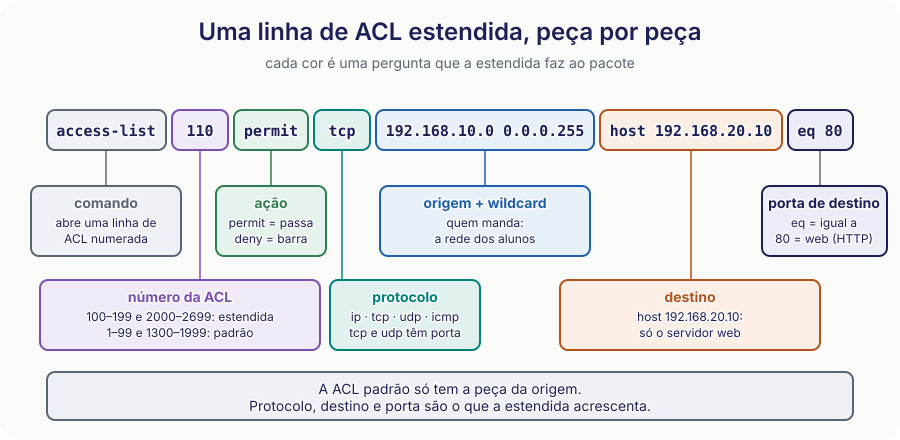
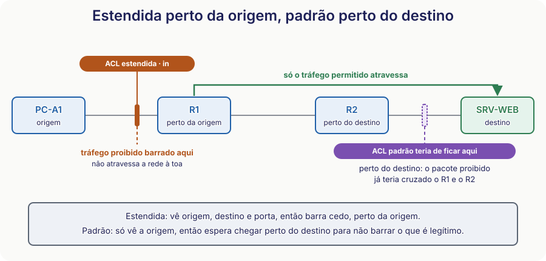
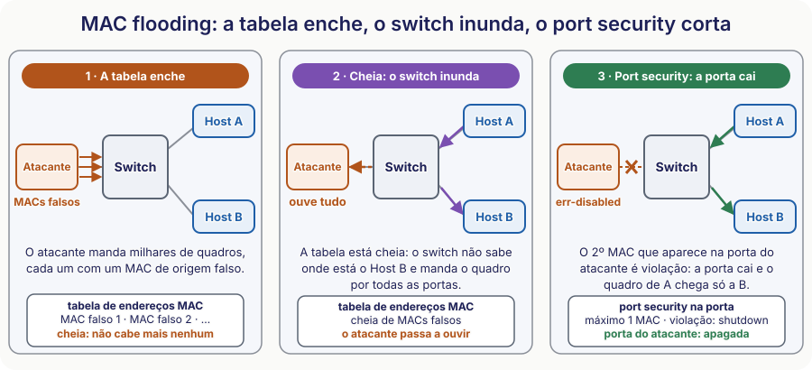
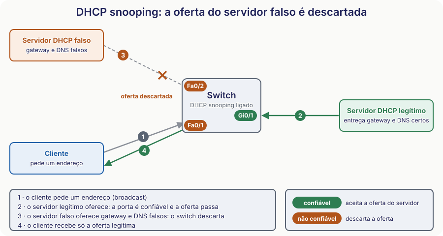

# 🟢 Aula 16 — ACLs estendidas e segurança de camada 2

**Disciplina:** {{CODIGO}} — Redes de Computadores II — Uniube 
**Professor:** Romualdo Mathias Filho · **romualdo.filho@uniube.br** 
**Data:** Terça, 10/11/2026 · {{PERIODO}} · **VIA203** · 📘 Teórica (75 min) 
**Turmas práticas:** P11 segunda · VIA215 — P12 quinta · VIA216 
**Página de referência:** [Plano de Ensino e Contrato](./Plano-de-Ensino-e-Contrato)

---

<b>Nosso caminho até aqui [⏳ 8 min]</b>

Tente responder de cabeça. Depois abra e confira. Três perguntas vêm da Aula 15 e uma vem do roteamento dinâmico. Todas são o chão da aula de hoje.

O que uma ACL (Access Control List) padrão avalia no pacote?

**Só o endereço IP (Internet Protocol) de origem.** Ela não olha destino, protocolo nem porta. Os números dela vão de 1 a 99.

Uma ACL tem só uma linha, <code>deny host 192.168.1.50</code>. O que acontece com o resto da rede?

**Fica tudo barrado.** Quem não casa em nenhuma linha cai no `deny` implícito do fim da lista. Toda ACL precisa de pelo menos um `permit`.

Onde a ACL padrão deve ficar, perto da origem ou do destino? Por quê?

**Perto do destino.** Ela só enxerga a origem. Perto da origem, ela barraria o host para qualquer destino, inclusive os legítimos.

O OSPF (Open Shortest Path First) escolhe o caminho pelo menor número de saltos?

**Não.** Ele escolhe pelo **menor custo acumulado**, e o custo vem da largura de banda do enlace. Contar saltos é o RIP (Routing Information Protocol), não o OSPF.

> [!INFO] 🎯 O que você leva desta aula
> - A **pergunta completa** que a ACL estendida faz ao pacote: quem, para onde e qual serviço.
> - Como ler uma linha de ACL estendida **peça por peça**, e onde aplicá-la: perto da origem.
> - Como um atacante enche a tabela de endereços MAC (Media Access Control) de um switch, e como o **port security** corta isso.
> - Como um servidor DHCP (Dynamic Host Configuration Protocol) falso engana a rede, e como o **DHCP snooping** descarta a oferta dele.
>
> **📂 Recursos**
> - [Plano de Ensino e Contrato](./Plano-de-Ensino-e-Contrato) — calendário, notas, prazos e regras
> - [Manual do IOS (Internetwork Operating System) no Packet Tracer](./Manual-do-IOS-no-Packet-Tracer) — comandos do semestre por tema
> - **Packet Tracer** — o [Lab 9 desta semana](./Aula-16---Lab-9-ACL-Estendida-e-Port-Security-(Pratica)) é o chão prático desta aula

---

## 📌 1. A ACL estendida: a pergunta completa e a linha por dentro [Teoria ⏳ 16 min]

### 1.1 A pergunta completa: quem, para onde, qual serviço

Na Aula 15 ficou uma pergunta aberta: "a rede dos alunos pode acessar o servidor web **na porta 80**, mas não pode acessar **nada mais** dele. Com uma ACL que só vê a origem, dá para escrever essa regra?"

Tente por um minuto, no papel: escreva essa política usando só ACL padrão. Você conseguiu?

**Não dá.** A ACL padrão só sabe "de onde veio". Ela pode liberar ou barrar a rede dos alunos **inteira**, nunca só a porta 80 de um servidor. Quem não conseguiu escrever acertou: o limite está na ferramenta, não em você.

> [!NOTE] 📖 Três protocolos e a porta 80
> **TCP (Transmission Control Protocol)** carrega a navegação na web. **UDP (User Datagram Protocol)** carrega as consultas rápidas, como as de DNS (Domain Name System). **ICMP (Internet Control Message Protocol)** carrega o `ping`. O servidor tem um endereço IP, que diz **qual máquina**. A porta diz **qual serviço** nela: a 80 é a do HTTP (HyperText Transfer Protocol), o site. É por isso que a estendida consegue liberar o site e barrar o resto da mesma máquina.

A **ACL estendida** enxerga os quatro campos que faltavam à padrão:

| A pergunta | ACL padrão | ACL estendida |
| :-- | :-- | :-- |
| **Quem** manda? (origem) | sim | sim |
| **Para onde** vai? (destino) | não | **sim** |
| **Qual protocolo?** (`ip`, `tcp`, `udp`, `icmp`) | não | **sim** |
| **Qual serviço?** (porta) | não | **sim** |

Veja a política da Aula 15 escrita com três linhas:

<b>R1</b> · "os alunos chegam ao servidor web, e só à porta 80"

R1(config)# access-list 110 permit tcp 192.168.10.0 0.0.0.255 host 192.168.20.10 eq 80
R1(config)# access-list 110 deny ip 192.168.10.0 0.0.0.255 host 192.168.20.10
R1(config)# access-list 110 permit ip any any
! 1: o site passa. 2: o resto desse servidor é barrado. 3: o resto da rede segue normal.

Aposte: se eu trocasse a linha 1 de lugar com a linha 2, o aluno ainda abriria o site?

**Não.** A linha `deny ip` casaria primeiro com qualquer pacote do aluno para aquele servidor, inclusive o da porta 80, e o roteador pararia de ler. A ordem das linhas continua sendo a política, também nas estendidas.

> [!TIP] 💡 A estendida herda tudo da padrão
> Primeiro match decide, `deny` implícito no fim, wildcard para a rede, `host` e `any` como atalhos. Só a pergunta ficou maior.

> [!WARNING] ⚠️ Mais campos, mais lugares para errar
> Na padrão você errava a ordem e a wildcard. Na estendida soma-se o protocolo e a porta: um `udp` no lugar de `tcp`, ou uma origem escrita no lugar do destino, e a linha nunca casa.

### 1.2 A linha por dentro: peças, números e portas

#### 1.2.1 A linha, peça por peça

Uma linha de estendida tem sete peças. Cada cor da figura é uma pergunta que a ACL faz ao pacote.

<figure class="au-fig">

<figcaption class="au-legenda">Figura 1: a linha <code>access-list 110 permit tcp 192.168.10.0 0.0.0.255 host 192.168.20.10 eq 80</code>, partida em peças. A padrão só tem a peça da origem. Protocolo, destino e porta são o que a estendida acrescenta.</figcaption>
</figure>

> [!TIP] 💡 A porta pertence a quem vem logo antes dela
> O `eq 80` está depois do destino, então é a porta **de destino**. Se estivesse logo depois da origem, seria a porta **de origem**. O IOS lê a porta como parte do endereço que a precede.

#### 1.2.2 ACLs numeradas e nomeadas: quando usar cada uma

| | ACL numerada | ACL nomeada |
| :-- | :-- | :-- |
| Estendida | `access-list 100` a `199`, e `2000` a `2699` | `ip access-list extended NOME` |
| Padrão | `access-list 1` a `99`, e `1300` a `1999` | `ip access-list standard NOME` |
| Editar uma linha | pelo comando `access-list` não dá para apagar uma linha só: `no access-list 110 ...` apaga a lista inteira. Pelo modo `ip access-list extended 110`, a numerada também aceita inserir e apagar por número de sequência | **inserir e apagar por número de sequência** |

Dentro do modo `ip access-list extended` (com um nome, ou com o número de uma numerada, como `110`), cada linha tem um **número de sequência** (10, 20, 30...). Você insere uma linha no meio escolhendo um número entre dois existentes e apaga uma linha só, com `no` e o número. Pelo comando global `access-list`, isso não existe.

<b>R1</b> · inserir a linha 15 e apagar a 20, sem refazer a lista

R1(config)# ip access-list extended WEB-ALUNOS
R1(config-ext-nacl)# 10 permit tcp 192.168.10.0 0.0.0.255 host 192.168.20.10 eq 80
R1(config-ext-nacl)# 20 permit icmp 192.168.10.0 0.0.0.255 host 192.168.20.10 echo
R1(config-ext-nacl)# 15 permit tcp 192.168.10.0 0.0.0.255 host 192.168.20.10 eq 443
R1(config-ext-nacl)# no 20
! o 15 entra entre o 10 e o 20; o "no 20" apaga só a linha do ping

<b>R1</b> · a lista fica ordenada pelo número de sequência

R1# show access-lists
Extended IP access list WEB-ALUNOS
    10 permit tcp 192.168.10.0 0.0.0.255 host 192.168.20.10 eq www
    15 permit tcp 192.168.10.0 0.0.0.255 host 192.168.20.10 eq 443
! o IOS mostra www no lugar de 80. A linha 20 sumiu.

> [!WARNING] ⚠️ Pelo comando <code>access-list</code>, o <code>no</code> apaga a lista inteira
> A Cisco avisa: não se apaga uma entrada de uma ACL numerada pelo comando `access-list`. Tentar com `no access-list 110 ...` apaga a lista toda. Para tirar uma linha só, entre no modo `ip access-list extended` e use `no` com o número de sequência.

#### 1.2.3 Operadores, portas e a palavra `established`

Para a porta, a estendida tem cinco operadores:

| Operador | Quer dizer | Exemplo |
| :-- | :-- | :-- |
| `eq` | igual a | `eq 80` |
| `neq` | diferente de | `neq 23` |
| `lt` | menor que | `lt 1024` |
| `gt` | maior que | `gt 1023` |
| `range` | de um número até outro | `range 20 21` |

> [!NOTE] 📖 O ICMP não tem porta
> O ICMP carrega o `ping`. Como não tem porta, a ACL o nomeia pelo tipo de mensagem, como `echo`.

As portas que você mais vai encontrar:

| Serviço | Porta | Transporte |
| :-- | :-- | :-- |
| FTP (File Transfer Protocol) | 20 e 21 | TCP |
| SSH (Secure Shell) | 22 | TCP |
| Telnet | 23 | TCP |
| SMTP (Simple Mail Transfer Protocol) | 25 | TCP |
| DNS | 53 | UDP (consultas) e TCP |
| DHCP | 67 e 68 | UDP |
| HTTP | 80 | TCP |
| HTTPS (HTTP Secure) | 443 | TCP |

A palavra `established`\* serve para liberar **só as respostas** de conexões que já foram abertas:

<b>R1</b> · deixa entrar só o que é resposta a uma conexão da rede interna

R1(config)# access-list 120 permit tcp any 192.168.10.0 0.0.0.255 established
! só casa resposta de conexão já aberta; o pedido inicial de uma conexão nova não casa

<b>*established</b> — palavra-chave do IOS, válida só para TCP. Ela casa o segmento que tem o bit ACK (acknowledgment, confirmação) ou o bit RST (reset, encerramento da conexão) ligado. O roteador não guarda uma lista de conexões: só confere os bits do pacote. Por isso a <code>established</code> ajuda, mas não substitui um firewall: quem forja um pacote com o bit ACK ligado também casa.

---

## 📌 2. Onde e em que sentido aplicar: a estendida vai perto da origem [Teoria ⏳ 8 min]

### 2.1 Estendida perto da origem, padrão perto do destino

A estendida sabe o destino. Isso muda a regra da Aula 15: ela pode ficar **perto da origem** sem barrar o que é legítimo, porque a linha diz exatamente qual tráfego cortar. E barrar cedo tem um ganho: o pacote proibido **nem atravessa** a rede.

<figure class="au-fig">

<figcaption class="au-legenda">Figura 2: a estendida fica na entrada do R1 e barra cedo. A padrão, que só vê a origem, teria de esperar até a porta do destino, depois de o pacote proibido atravessar dois roteadores.</figcaption>
</figure>

| Tipo de ACL | Onde fica | Por quê |
| :-- | :-- | :-- |
| **Padrão** (só origem) | o mais **perto do destino** | não sabe o destino; cedo demais, barra o host para todo lugar |
| **Estendida** (origem, destino, protocolo e porta) | o mais **perto da origem** | sabe o destino; barra cedo e poupa a rede |

### 2.2 Entrada ou saída, e as regras de uma ACL por interface

Aplicar a ACL é escolher a interface e o sentido:

<b>R1</b> · aplicar a ACL na entrada da interface que vem da origem

R1(config)# interface GigabitEthernet0/0
R1(config-if)# ip access-group WEB-ALUNOS in
! in filtra o que ENTRA pela g0/0. Com out, filtraria o que SAI por ela.

| Sentido | Filtra o que... | Detalhe que cai em prova |
| :-- | :-- | :-- |
| `in` | entra pela interface, antes de o roteador escolher a rota | o pacote barrado nem chega a ser roteado |
| `out` | sai pela interface, depois de o roteador escolher a rota | **não filtra o tráfego que o próprio roteador gera** |

Três regras para guardar:

1. Cada interface aceita **uma ACL por sentido** (uma `in` e uma `out`).
2. Isso vale **por protocolo**: o IPv4 (Internet Protocol versão 4) e o IPv6 (versão 6) têm ACLs separadas.
3. A ACL de saída ignora o tráfego que o roteador cria, como um `ping` que você dá a partir dele.

Aposte: uma ACL <code>out</code> na <code>g0/1</code> barra o <code>ping</code> que o próprio R1 dá no servidor?

**Não.** A ACL de saída não filtra o tráfego gerado pelo próprio roteador. O mesmo `ping`, dado de um PC da rede e passando pelo R1, seria avaliado pela ACL. Quem testa uma ACL a partir do roteador pode concluir, errado, que ela não funciona.

> [!TIP] 💡 A frase de bolso
> **"Padrão no destino, estendida na origem."** A lógica é a mesma nos dois: aplique onde a ACL tem informação suficiente para não barrar o que é legítimo.

---

<b>🔌 Momento interativo — vote antes de ver a resposta</b>

Uma ACL estendida está aplicada `in` na `g0/0` do R1, com três linhas: `10 deny ip 192.168.10.0 0.0.0.255 192.168.20.0 0.0.0.255` · `20 permit tcp 192.168.10.0 0.0.0.255 host 192.168.20.10 eq 80` · `30 permit ip any any`. Um aluno (`192.168.10.11`) tenta abrir o site do servidor `192.168.20.10`. **O site abre?** (A) abre, porque a linha 20 libera a porta 80 · (B) abre, porque a linha 30 libera tudo · (C) não abre, porque a linha 10 casa primeiro · (D) não abre, porque a estendida não olha a porta. Vote no Plickers.

<b>Plano B — se o Plickers ou a internet do campus cair:</b> levante os dedos, um dedo para A, dois para B, três para C e quatro para D. Converse com o colega ao lado, vote de novo, e a resposta vem logo depois.

Depois de votar, confira a resposta

**C.** O pacote do aluno casa na linha 10 (a rede dos alunos para a rede dos servidores), e o roteador para de ler ali. A exceção da linha 20 nunca é vista. É o mesmo erro da exceção depois da regra geral, agora com protocolo e porta. A correção: a linha 20 vem **antes** da 10.

> [!NOTE] ⏸️ Pausa procedural — 2 minutos
> Comparem as anotações com quem está ao lado. Eu fico calado. Marquem uma coisa que ainda não sabem explicar com as próprias palavras.

---

## 📌 3. Segurança de camada 2: port security e DHCP snooping [Teoria ⏳ 18 min]

### 3.1 Camada 2 é a porta de entrada: MAC flooding e port security

Até aqui a defesa estava no roteador, na camada 3. Mas o atacante muitas vezes está **dentro**, plugado numa tomada do mesmo switch que você. Imagine uma tomada de rede esquecida numa sala de reuniões: qualquer notebook ligado nela já fala com a camada 2 da sua rede.

#### 3.1.1 O ataque: encher a tabela

O switch aprende sozinho. Cada quadro que chega ensina a ele "este endereço MAC está nesta porta", e ele guarda isso na **tabela de endereços MAC**, também chamada de tabela CAM (Content Addressable Memory, a memória onde ela fica). A tabela tem tamanho limitado.

<figure class="au-fig">

<figcaption class="au-legenda">Figura 3: o <b>MAC flooding</b> em três passos. O ataque usa o aprendizado do switch contra ele. O port security responde no passo 3: a porta do atacante cai no segundo endereço MAC.</figcaption>
</figure>

1. O atacante manda milhares de quadros, **cada um com um MAC de origem falso**.
2. O switch aprende cada um e a tabela de endereços MAC, que é do switch inteiro, **enche**.
3. A entrada de um host legítimo que já estava na tabela vale até expirar (300 segundos por padrão nos switches Cisco). O ataque mantém a tabela cheia, então o endereço que expirou, como o do Host B, não volta a caber. Um quadro para um destino que não está na tabela não tem porta conhecida.
4. O switch passa a **inundar**\* esse quadro: manda por todas as portas da VLAN (Virtual LAN) em que ele chegou. O atacante, numa delas, **passa a ouvir** o que não era para ele.

<b>*inundar</b> — em inglês, <i>flooding</i>. É o que o switch faz com um quadro cujo destino ele não conhece: manda uma cópia por todas as portas da VLAN, menos a de onde o quadro veio.

Aposte: quando a tabela está cheia, o switch para de encaminhar os quadros dos hosts legítimos?

**Não, e é isso que torna o ataque perigoso.** A rede segue entregando os quadros, só que por inundação. O que mudou é que o atacante agora **ouve** o tráfego.

#### 3.1.2 A defesa: port security

O **port security** limita **quantos** endereços MAC e **quais** podem usar cada porta. Cabe ao administrador escolher como a porta fica sabendo desses endereços. São três tipos de endereço MAC seguro:

| Tipo | Como entra na porta | Onde fica | Sobrevive ao reinício? |
| :-- | :-- | :-- | :-- |
| **Estático** | digitado: `switchport port-security mac-address MAC` | tabela e `running-config` | só se você salvar a configuração |
| **Dinâmico** | aprendido sozinho | só na tabela | **não** |
| **Sticky**\* | aprendido sozinho e gravado | tabela e `running-config` | só se você salvar a configuração |

<b>S1</b> · port security: um MAC por porta, aprendido sozinho

S1(config)# interface FastEthernet0/1
S1(config-if)# switchport mode access
S1(config-if)# switchport port-security
S1(config-if)# switchport port-security maximum 1
S1(config-if)# switchport port-security mac-address sticky
S1(config-if)# switchport port-security violation shutdown
! sem o "switchport mode access", o IOS recusa: a porta ainda negocia o modo

<b>*sticky</b> — "grudento". O switch aprende o MAC da porta e o grava na configuração em andamento (<code>running-config</code>), como se você o tivesse digitado.

> [!WARNING] ⚠️ O sticky some se você não salvar
> O endereço sticky vai para a `running-config`. Sem `copy running-config startup-config`, ele se perde quando o switch reinicia.

#### 3.1.3 O que acontece na violação

**Violação** é quando chega um MAC novo e a porta já atingiu o máximo. O que o switch faz depende do modo:

| Modo | O que o switch faz com o quadro do MAC novo | A porta |
| :-- | :-- | :-- |
| `protect` | descarta, sem avisar | continua ligada |
| `restrict` | descarta, avisa (log e SNMP, Simple Network Management Protocol) e soma no contador | continua ligada |
| `shutdown` (padrão) | derruba a porta para o estado err-disabled\* e soma no contador | **cai** |

<b>*err-disabled</b> — estado em que o switch desliga a porta sozinho depois de detectar um problema. A porta fica apagada até alguém religar.

Para religar uma porta que caiu por violação, o caminho manual é `shutdown` e depois `no shutdown`. O IOS também tem uma recuperação automática, que **não vem ligada**:

<b>S1</b> · religar a porta caída (manual) e a recuperação automática (opcional)

S1(config)# interface FastEthernet0/1
S1(config-if)# shutdown
S1(config-if)# no shutdown
S1(config-if)# exit
S1(config)# errdisable recovery cause psecure-violation
! a última linha religa sozinha as portas derrubadas por violação de port security

> [!NOTE] 🃏 ConcepTest Plickers #2
> Uma porta do switch tem port security com `maximum 1` e `violation shutdown`. Nela está ligado um telefone IP com um PC atrás dele. O telefone e o PC mandam quadros pela mesma porta, cada um com o seu endereço MAC, e a porta **não** tem VLAN de voz\* configurada. **O que acontece?** (A) os dois funcionam, porque a porta aceita qualquer MAC enquanto há espaço na tabela · (B) o primeiro MAC que aparece passa; quando o segundo aparece, a porta vai para `err-disabled` e os dois perdem a rede · (C) o segundo MAC é ignorado em silêncio e o primeiro continua funcionando · (D) o switch troca o MAC do primeiro pelo do segundo.

<b>*VLAN de voz</b> — uma VLAN reservada ao tráfego do telefone IP, configurada na porta. Com ela, a mesma porta carrega a VLAN de dados do PC e a VLAN de voz do telefone. Aqui a porta não tem essa configuração, então o telefone e o PC aparecem na porta como dois endereços MAC.

Depois de votar, confira a resposta

**B.** Com `maximum 1`, só um MAC cabe. O segundo é uma violação e, no modo `shutdown`, a porta cai para os dois aparelhos. A opção C descreveria o modo `protect`, que não é o configurado. A documentação da Cisco recomenda `maximum 2` quando a porta tem VLAN de voz, justamente por causa do telefone.

### 3.2 O servidor DHCP falso e o DHCP snooping

#### 3.2.1 O ataque: quem responde primeiro leva

O DHCP entrega a configuração de rede ao cliente: endereço IP, gateway e DNS. A conversa tem quatro mensagens:

| Mensagem | Quem manda | O que diz |
| :-- | :-- | :-- |
| `DHCPDISCOVER` | cliente (em broadcast) | "tem algum servidor aí?" |
| `DHCPOFFER` | servidor | "ofereço este endereço, este gateway e este DNS" |
| `DHCPREQUEST` | cliente | "aceito esta oferta" |
| `DHCPACK` | servidor | "confirmado" |

O cliente fala em broadcast, então **qualquer** servidor na rede escuta. Um servidor DHCP clandestino, ligado numa tomada qualquer, pode responder antes do legítimo e entregar um gateway e um DNS falsos. O cliente em geral aceita a primeira oferta que chega, e passa a mandar o tráfego para o atacante.

<figure class="au-fig">

<figcaption class="au-legenda">Figura 4: o <b>DHCP snooping</b>* separa portas confiáveis de não confiáveis. A oferta do servidor falso chega por uma porta não confiável e é descartada. O cliente só recebe a oferta legítima.</figcaption>
</figure>

<b>*snooping</b> — "espiar". O switch lê as mensagens DHCP que passam por ele, em vez de só encaminhá-las, para decidir quais deixa passar.

#### 3.2.2 A defesa: portas confiáveis e não confiáveis

O switch descarta `DHCPOFFER`, `DHCPACK` e `DHCPNAK` que chegam por porta **não confiável**. Todo servidor DHCP legítimo precisa estar atrás de uma porta **confiável**.

<b>S1</b> · ligar o snooping na VLAN 10, confiar no uplink do servidor legítimo e limitar o resto

S1(config)# ip dhcp snooping
S1(config)# ip dhcp snooping vlan 10
S1(config)# interface GigabitEthernet0/1
S1(config-if)# ip dhcp snooping trust
S1(config-if)# interface range FastEthernet0/1 - 2
S1(config-if-range)# ip dhcp snooping limit rate 10
! uplink = a porta que leva ao servidor legítimo (ou a outro switch). As demais seguem não confiáveis.

| Comando | O que faz |
| :-- | :-- |
| `ip dhcp snooping` | liga o recurso no switch |
| `ip dhcp snooping vlan 10` | diz em quais VLANs ele vale |
| `ip dhcp snooping trust` | marca a porta como confiável (uplink do servidor legítimo) |
| `ip dhcp snooping limit rate 10` | limita a 10 pacotes DHCP por segundo na porta não confiável |

Aposte: você liga o snooping na VLAN 10 e esquece de marcar como confiável a porta do servidor DHCP <b>legítimo</b>. O que acontece com os clientes?

**Ficam sem endereço.** O switch descarta as ofertas do servidor legítimo, porque elas chegam por uma porta não confiável. Para o switch, o servidor verdadeiro é indistinguível de um falso. É um erro frequente de configuração, e o sintoma é rede "morta" logo depois de ligar o snooping.

Enquanto fiscaliza, o switch monta a **tabela de vínculos** (em inglês, *binding table*): para cada cliente de uma porta não confiável, guarda o endereço MAC, o IP, o tempo de concessão, o tipo, a VLAN e a interface, e o `show ip dhcp snooping binding` a mostra. O ARP (Address Resolution Protocol) é o protocolo que associa um IP a um MAC. A DAI (Dynamic ARP Inspection) confere todo pacote ARP, pedido ou resposta, que chega por porta não confiável, contra a tabela de vínculos do DHCP snooping. O IP Source Guard confere o IP de origem dos pacotes contra a mesma tabela.

---

<b>🎧 Podcast da Aula 16 — ACLs estendidas e segurança de camada 2</b>

O áudio chega em breve — gerado por IA a partir do material da disciplina.

<b>📋 Resumo — a folha de consulta</b>

| Conceito | O que é | Como lembrar |
|---|---|---|
| ACL estendida | filtra origem, destino, protocolo e porta | "a pergunta completa": quem, para onde, qual serviço |
| Numeração | `100` a `199` e `2000` a `2699` | padrão é 1–99; estendida passa de 100 |
| Editar linha de ACL | modo `ip access-list extended`, com nome ou número, e número de sequência | insere com `15`, apaga com `no 20`; no `access-list` global, o `no` apaga tudo |
| Operadores de porta | `eq`, `neq`, `lt`, `gt`, `range` | a porta pertence ao endereço que vem antes |
| `established` | casa TCP com ACK ou RST | resposta de conexão já aberta, não é firewall |
| Posição | estendida perto da origem; padrão perto do destino | "padrão no destino, estendida na origem" |
| `in` e `out` | `in` filtra o que entra; `out`, o que sai | `out` não filtra o tráfego do próprio roteador |
| MAC flooding | encher a tabela de MAC; o switch inunda e o atacante ouve | a rede segue funcionando, só que vazando |
| Port security | limita quantos e quais MAC cada porta aceita | estático, dinâmico e sticky |
| Modos de violação | `protect`, `restrict` e `shutdown` | só o `shutdown` derruba a porta |
| `err-disabled` | porta desligada pelo switch | religa com `shutdown` e `no shutdown` |
| DHCP snooping | portas confiáveis aceitam oferta; as outras descartam | servidor legítimo atrás de porta confiável |
| Tabela de vínculos | MAC, IP, concessão, tipo, VLAN e interface | DAI e IP Source Guard usam a mesma |

| O erro clássico | A correção |
|---|---|
| a exceção depois da regra geral | específico antes do geral, também nas estendidas |
| `no access-list 110 ...` para tirar uma linha | apaga a lista inteira; edite pelo modo `ip access-list extended` com o número de sequência |
| `udp` no lugar de `tcp`, ou origem e destino trocados | a linha nunca casa; releia peça por peça |
| ACL `out` que "não funciona" | o contador do `deny` parado: o sentido ou a interface estão errados |
| testar a ACL com `ping` a partir do roteador | a ACL `out` ignora o tráfego que o roteador gera |
| port security sem `switchport mode access` | o IOS recusa; fixe a porta como acesso antes |
| porta apagada depois de ligar um aparelho novo | `err-disabled`: `shutdown` e `no shutdown` |
| snooping ligado e a rede "morreu" | o servidor DHCP legítimo está atrás de porta não confiável |

---

<b>🤔 Para pensar até a próxima aula</b>

Hoje o port security amarrou um endereço MAC a uma porta física. Mas o MAC de uma placa pode ser trocado por software, e quem o troca passa a ter o endereço do dono da porta. Isso basta para abrir a porta? E numa rede sem fio, onde não existe porta nem cabo, **como se amarra quem entra**? Traga a sua hipótese.

*Não há resposta nesta página de propósito.*

---

<b>📚 O que sustenta esta aula, com página</b>

- **CISCO SYSTEMS.** *Security Configuration Guide, Cisco IOS 15.2(7)Ex (Catalyst 2960-L)*: Port Security. Disponível em: [cisco.com](https://www.cisco.com/c/en/us/td/docs/switches/lan/catalyst2960l/software/15-2_7_e/configuration_guide/sec/b_1527e_security_2960l_cg/port_security.html). Acesso em: 8 nov. 2026. seção Port Security — tipos de endereço MAC seguro, modos de violação, err-disabled e recuperação.
- **CISCO SYSTEMS.** *Catalyst 2960 Software Configuration Guide, 15.2(1)E*: Configuring DHCP and IP Source Guard Features. Disponível em: [cisco.com](https://www.cisco.com/c/en/us/td/docs/switches/lan/catalyst2960/software/release/15-2_1_e/configuration/guide/2960_scg/swdhcp82.html). Acesso em: 8 nov. 2026. seção Understanding DHCP Snooping — portas confiáveis e não confiáveis, mensagens descartadas e tabela de vínculos.
- **CISCO SYSTEMS.** *Security Configuration Guide: Access Control Lists, Cisco IOS Release 15M&T.* IP Access List Overview. Disponível em: [cisco.com](https://www.cisco.com/c/en/us/td/docs/ios-xml/ios/sec_data_acl/configuration/15-mt/sec-data-acl-15-mt-book/sec-access-list-ov.html). Acesso em: 8 nov. 2026. seções Access List Rules e Software Processing of an Access List — uma ACL por interface, por protocolo e por sentido; o `deny` implícito no fim; a ACL de entrada age antes do roteamento e a de saída depois; a ACL não filtra o tráfego que nasce no equipamento; o pacote negado é descartado e o roteador devolve um ICMP de host inalcançável; as faixas de numeração; tentar apagar uma entrada de ACL numerada pelo comando `access-list` apaga a lista inteira.
- **CISCO NETWORKING ACADEMY.** *CCNA: Switching, Routing, and Wireless Essentials (SRWE).* Cisco Systems, 2026. Disponível em: https://www.netacad.com/. Acesso em: 8 nov. 2026. numeração da versão 7.0, módulo 10, LAN Security Concepts — ataques de camada 2 e as defesas, como port security e DHCP snooping.
- **CISCO NETWORKING ACADEMY.** *CCNA: Switching, Routing, and Wireless Essentials (SRWE).* Cisco Systems, 2026. Disponível em: https://www.netacad.com/. Acesso em: 8 nov. 2026. numeração da versão 7.0, módulo 11, Switch Security Configuration — configuração de segurança de switch.
- **CISCO NETWORKING ACADEMY.** *CCNA: Enterprise Networking, Security, and Automation (ENSA).* Cisco Systems, 2026. Disponível em: https://www.netacad.com/. Acesso em: 8 nov. 2026. numeração da versão 7.0, módulo 4, ACL Concepts — como as ACLs filtram o tráfego.
- **CISCO NETWORKING ACADEMY.** *CCNA: Enterprise Networking, Security, and Automation (ENSA).* Cisco Systems, 2026. Disponível em: https://www.netacad.com/. Acesso em: 8 nov. 2026. numeração da versão 7.0, módulo 5, ACLs for IPv4 Configuration — configuração de ACLs IPv4.
- **DROMS, R.** *RFC 2131: Dynamic Host Configuration Protocol.* IETF, mar. 1997. Disponível em: https://www.rfc-editor.org/rfc/rfc2131. Acesso em: 8 nov. 2026. seç. 3.1 — as quatro mensagens do DHCP.
- **EDDY, W. (ed.).** *RFC 9293: Transmission Control Protocol (TCP).* IETF, ago. 2022. Disponível em: https://www.rfc-editor.org/rfc/rfc9293. Acesso em: 8 nov. 2026. seç. 3.1 — os bits ACK e RST que o `established` confere.

<b>➡️ Na próxima aula</b>

Hoje toda defesa dependia de um cabo e de uma porta: a ACL filtrava o que passava pelo roteador, o port security prendia um endereço MAC a uma porta física. Na S17 o cabo some. Entra a **rede sem fio**: o padrão 802.11, a segurança WPA2 e WPA3 (Wi-Fi Protected Access) e a configuração. O Lab 10 é onde você monta isso.

